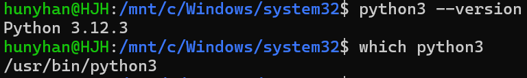
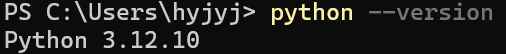
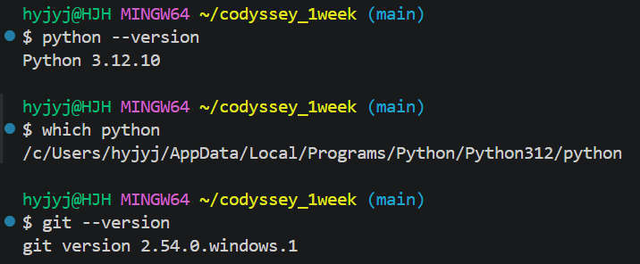

# 개발 환경

[← README로 돌아가기](../README.md)

Windows와 WSL Ubuntu의 Python 버전을 확인하고, 과제는 VSCode 안의 Git Bash에서 Windows Python 3.12.10으로 진행하기로 정했습니다.

## 파이썬 실행 환경 확인

### 버전과 위치 확인

*Ubuntu에서 python3 --version은 3.12.3, which python3는 /usr/bin/python3*

*Windows PowerShell에서 python --version은 Python 3.12.10*

## VSCode 터미널 확인과 프로젝트 폴더 정하기

### VSCode Git Bash 확인

*VSCode Git Bash에서 python --version은 3.12.10, which python은 /c/Users/hyjyj/AppData/Local/Programs/Python/Python312/python, git --version은 2.54.0.windows.1*
