# 연습 저장소와 Git 기본 명령

[← README로 돌아가기](../README.md)

연습용 저장소 `codyssey_2week`에서 `git init`, `git remote add`, `.gitignore`, 첫 `add`·`commit`·`push`를 직접 해 보았습니다. 과제 저장소는 이후 `clone`으로 새로 시작했습니다(05).

## GitHub 저장소와 git init

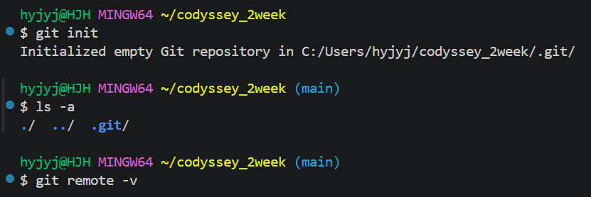

*git init 뒤 프롬프트에 main이 나타나고 ls -a에 .git이 보이며 git remote -v는 출력이 없다*

## 프롬프트의 (main)

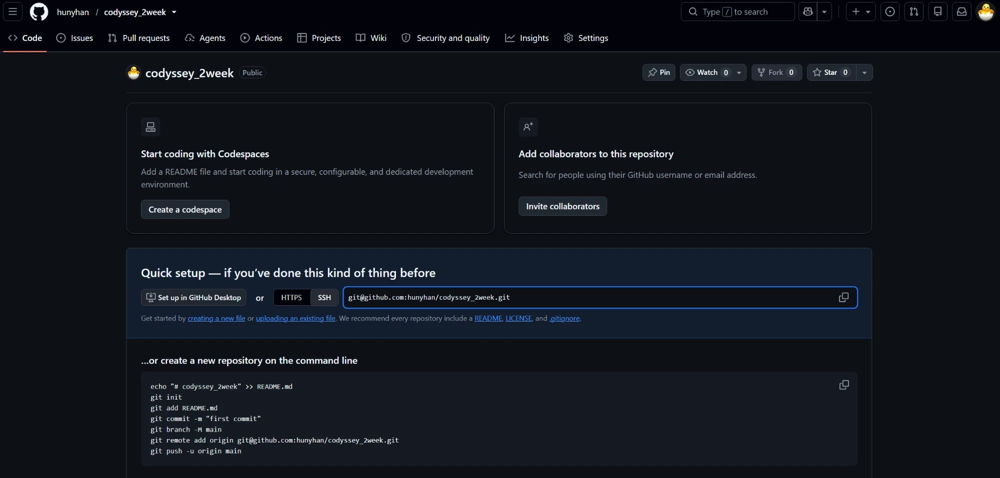

*GitHub에 만든 빈 공개 저장소 hunyhan/codyssey_2week의 Quick setup 화면*

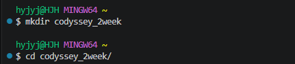

*홈에서 mkdir codyssey_2week와 cd codyssey_2week/를 실행한 터미널*

## 원격 연결

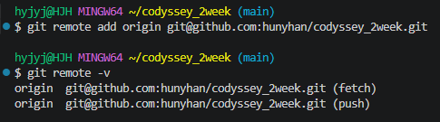

*git remote add 뒤 git remote -v에 origin SSH 주소가 fetch와 push 두 줄로 나온다*

## .gitignore와 README.md 만들기

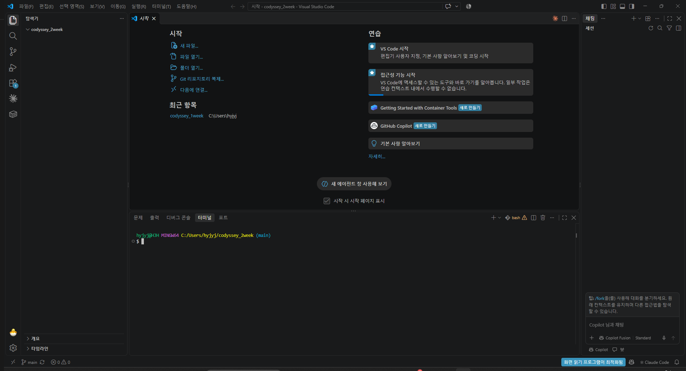

*code .으로 codyssey_2week 폴더를 연 VSCode*

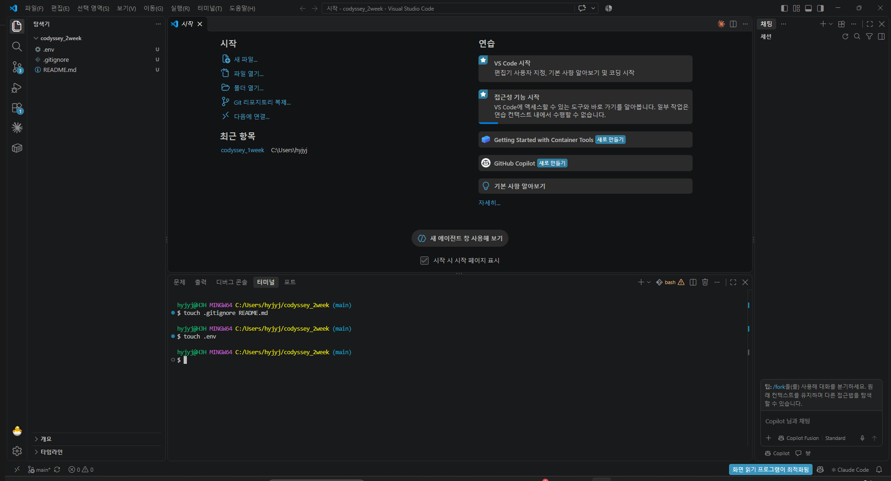

*VSCode 터미널에서 touch로 .gitignore, README.md, .env를 만든 화면*

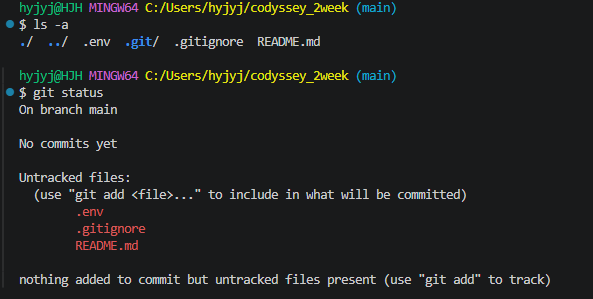

*git status의 Untracked files에 .env, .gitignore, README.md 세 개가 나온다*

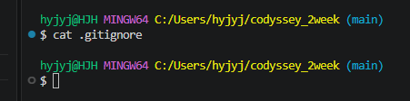

*cat .gitignore 결과가 비어 있다*

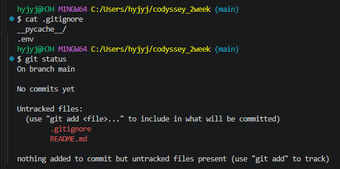

*cat .gitignore에 두 줄이 있고 git status에서 .env가 사라졌다*

## 첫 커밋과 푸시

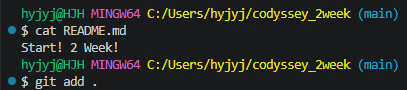

*cat README.md 결과 Start! 2 Week!와 git add .*

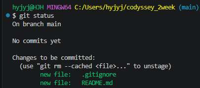

*git status의 Changes to be committed에 .gitignore와 README.md*

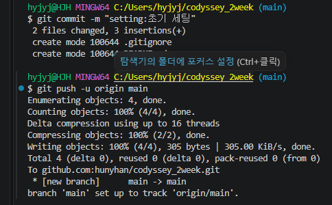

*git commit과 git push -u origin main 성공 화면*

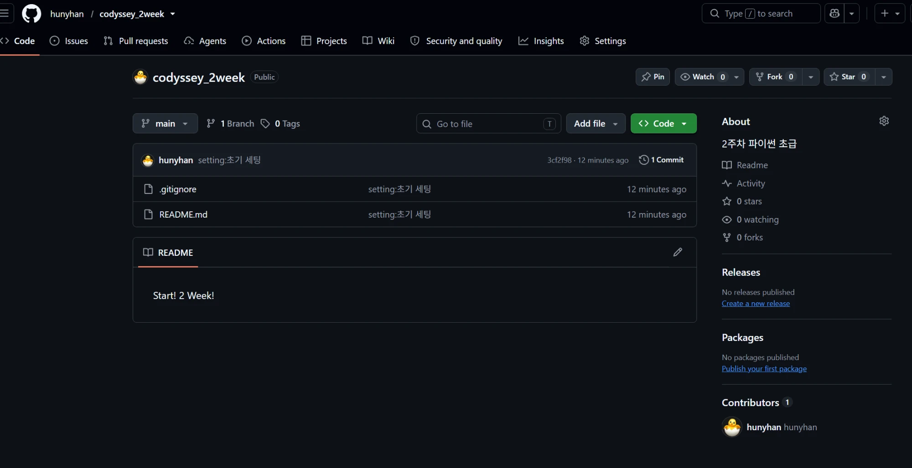

*GitHub 저장소에 .gitignore와 README.md만 있고 커밋 3cf2f98이 1개 보인다*
