# Python 입력과 예외 처리 연습

[← README로 돌아가기](../README.md)

대화형 모드와 작은 연습 파일로 `input()`이 문자열을 돌려준다는 것, `int()` 변환 실패(`ValueError`), `while True`와 `continue`·`break`로 다시 묻기, 범위 검사를 익혔습니다.

## input과 int 변환

### 대화형 모드에서 실행

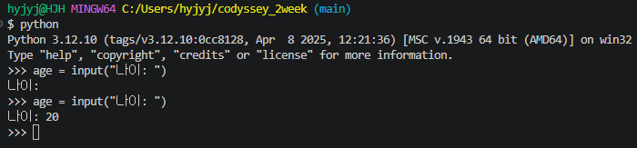

*대화형 모드에서 input을 두 번 실행했다. 첫 번째는 빈 입력, 두 번째는 20*

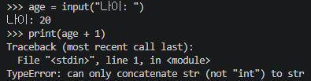

*print(age + 1)이 TypeError로 멈춘 화면*

### 오류 메시지 읽기와 변환

*print(age) 결과 20*

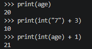

*print(int("7") + 3)은 10, 직접 쓴 print(int(age) + 1)은 21*

### 변환할 수 없는 입력

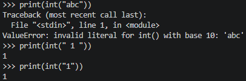

*int("abc")는 ValueError, int(" 1 ")과 int("1")은 1*

### int()가 받아들이는 문자열

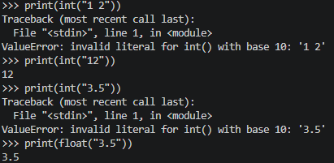

*int("1 2")와 int("3.5")는 ValueError, int("12")는 12, float("3.5")는 3.5*

## 잘못된 입력에 멈추지 않기

### 파일로 만들어 실행

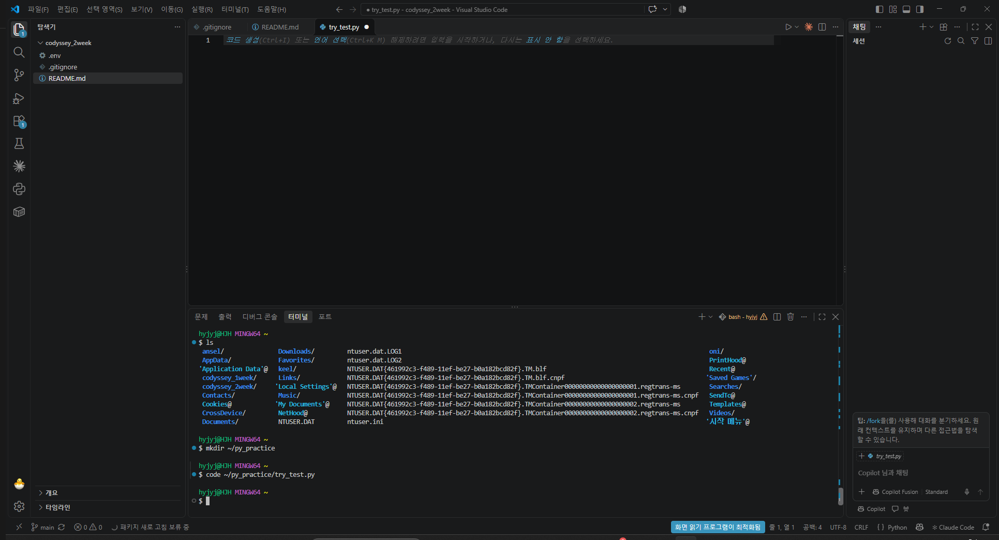

*py_practice 폴더를 만들고 code로 try_test.py를 연 VSCode*

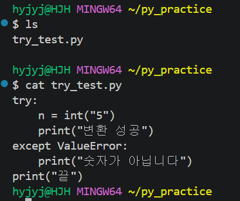

*ls와 cat으로 확인한 try_test.py 6줄*

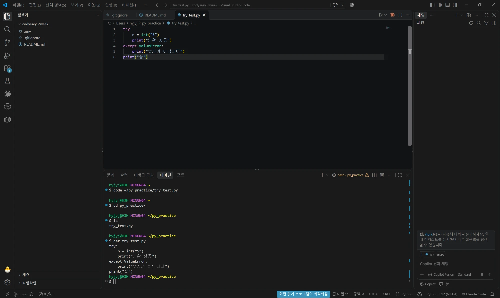

*VSCode에서 직접 입력한 try_test.py*

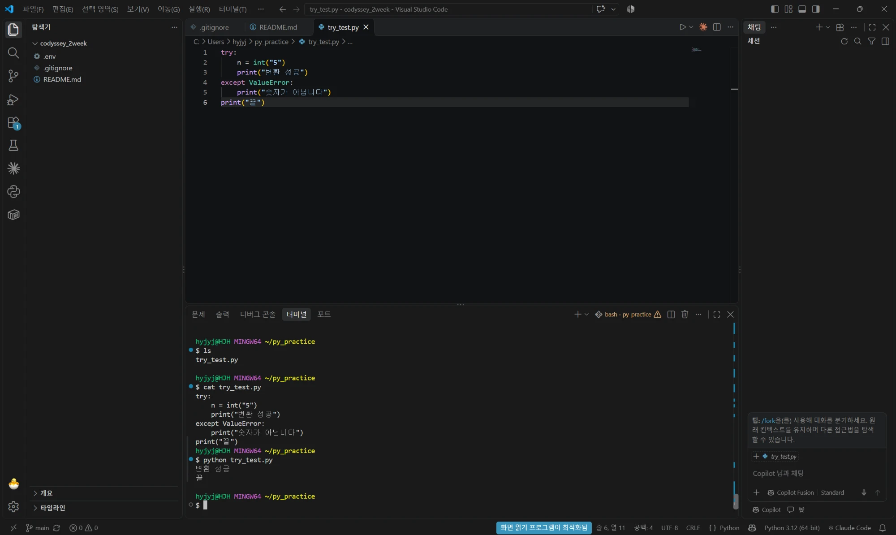

*try_test.py를 "5"로 실행한 결과 변환 성공, 끝*

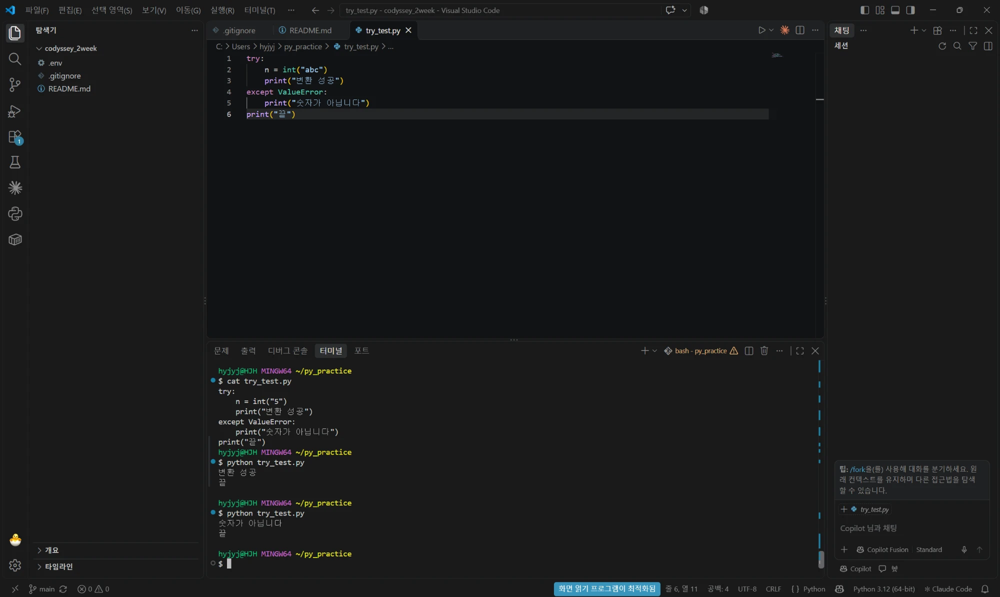

*try_test.py를 "abc"로 실행한 결과 숫자가 아닙니다, 끝*

### 반복 구조를 코드로 쓰기

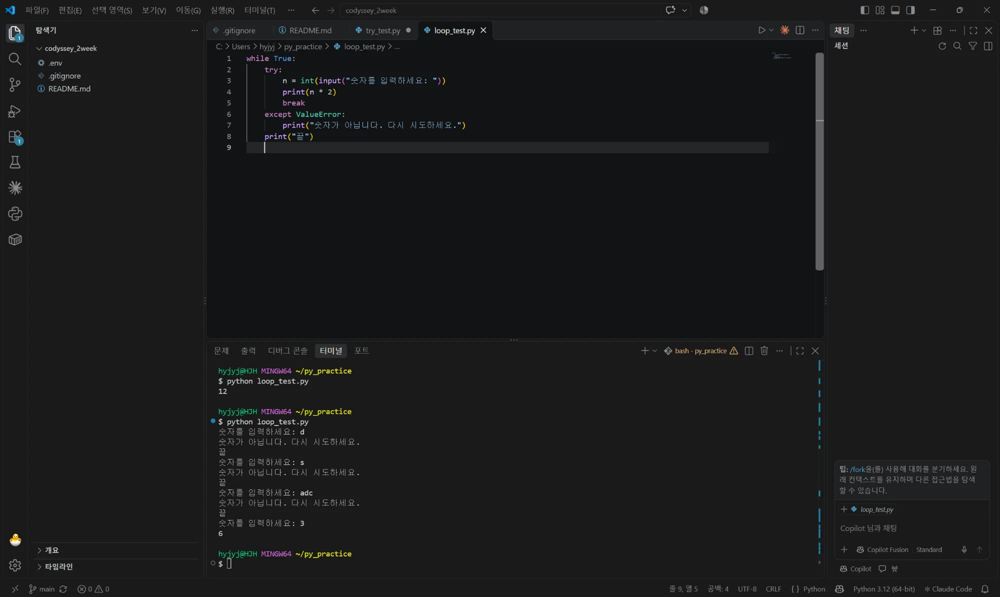

*직접 쓴 loop_test.py와 실행 결과. 틀릴 때마다 끝이 나오고 3을 넣으면 6만 나온다*

### 끝이 속한 묶음과 break

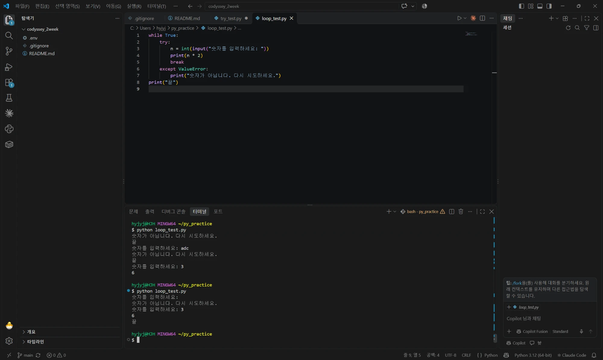

*끝을 맨 앞으로 옮긴 뒤 마지막에 한 번만 나오고, 그냥 Enter도 다시 묻는다*

### 그냥 Enter와 빈 문자열

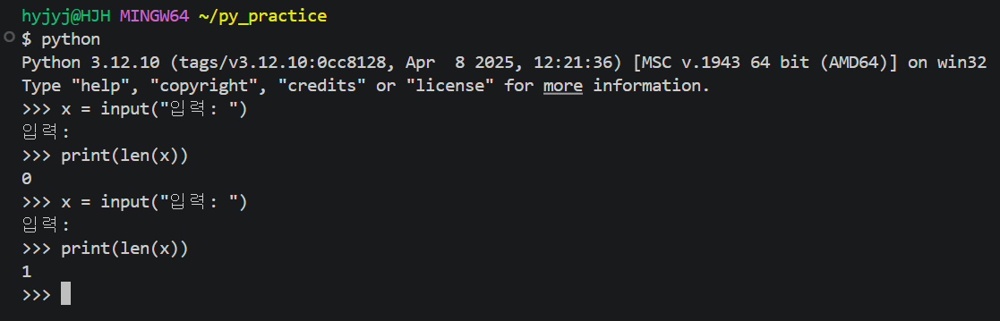

*그냥 Enter는 len 0, 스페이스바 한 번은 len 1*

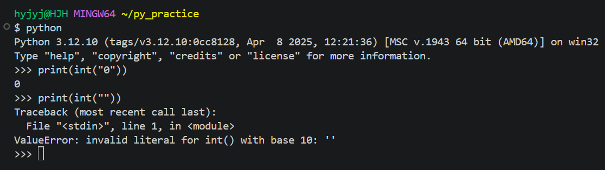

*int("0")은 0, int("")은 ValueError와 따옴표 안이 빈 ''*

## 범위 밖 숫자 처리

### 주사위 눈 받기

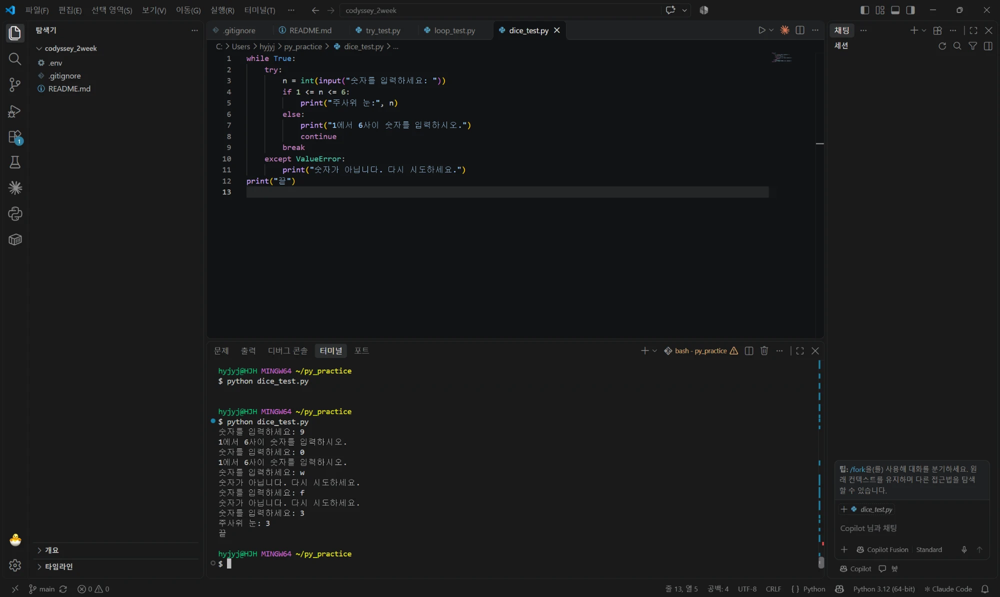

*직접 쓴 dice_test.py와 실행 결과. 9, 0은 범위 안내, w, f는 숫자 아님, 3은 주사위 눈: 3*

### continue를 지우면

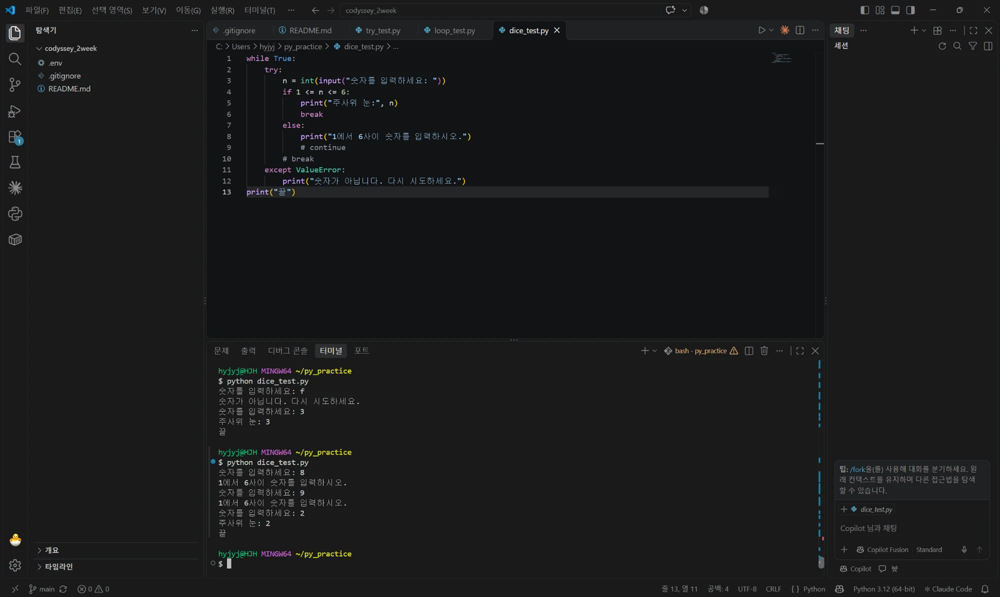

*break를 if 안으로 옮기고 continue와 원래 break를 #으로 막은 dice_test.py. 8, 9는 다시 묻고 2에서 끝난다*
