# 메뉴와 Quiz 클래스 첫 작성

[← README로 돌아가기](../README.md)

연습 저장소에서 메뉴 코드와 `Quiz` 클래스를 처음 직접 썼습니다. 빈 입력·숫자 아님·범위 밖 처리와 `__init__`, `self`, 메서드를 단계별로 확인했습니다.

## 메뉴 코드 작성과 첫 기능 커밋

### 메뉴 코드 쓰기

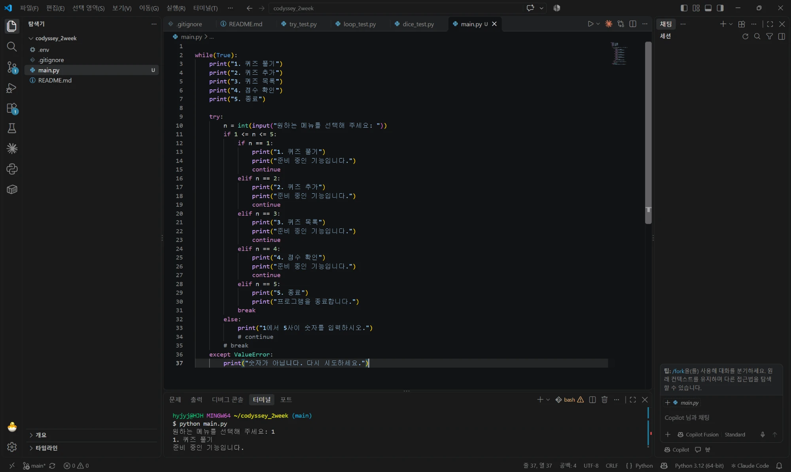

*직접 쓴 첫 main.py. while 안에 메뉴 출력, try, if 1 <= n <= 5 안에 if/elif, 1~4번마다 continue*

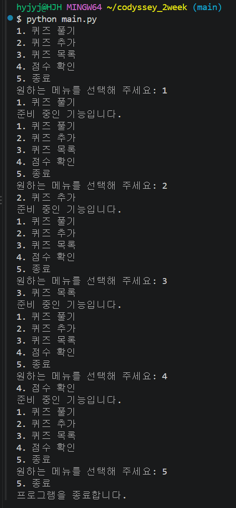

*main.py를 1~5 순서로 실행. 1~4는 준비 중 안내 후 메뉴, 5에서 종료*

### 남은 입력 확인

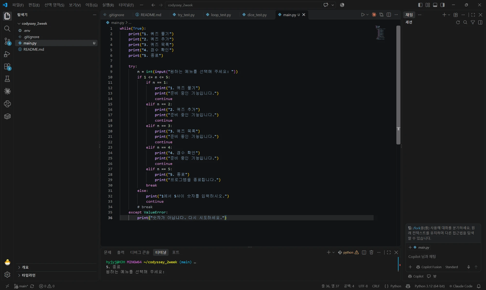

*9번째 줄에서 input과 int가 한 줄에 붙은 main.py*

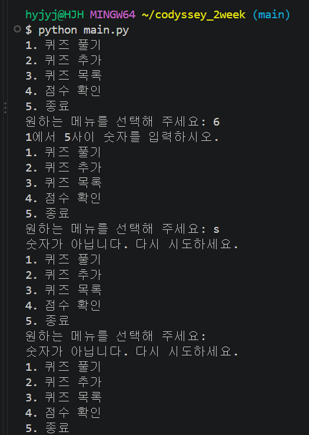

*6은 범위 안내, s는 숫자 아님, 그냥 Enter도 숫자가 아닙니다로 나온다*

### main.py에 넣고 다시 확인

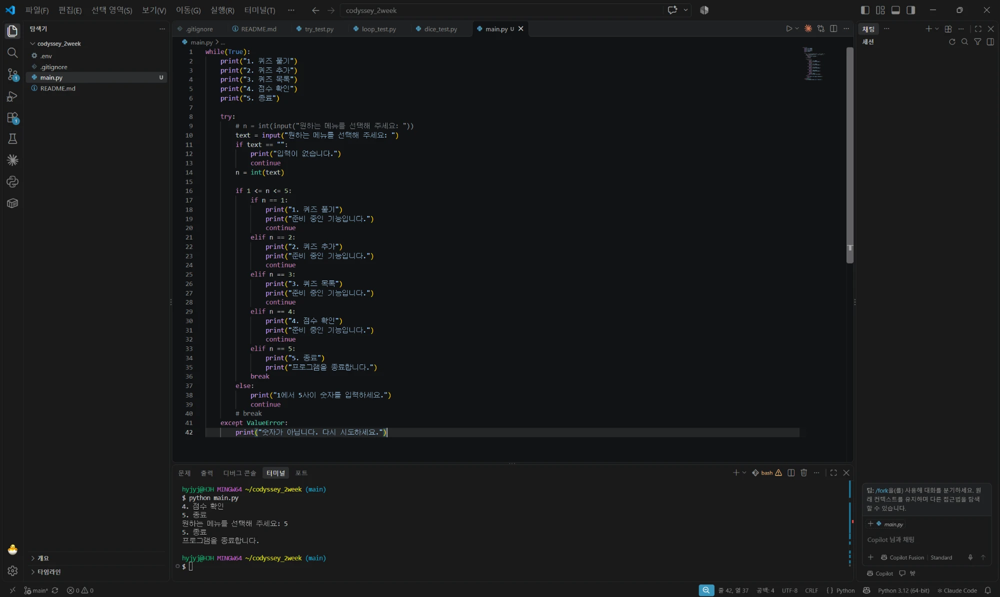

*input과 int를 나누고 if text == "" 아래에 continue를 넣은 main.py*

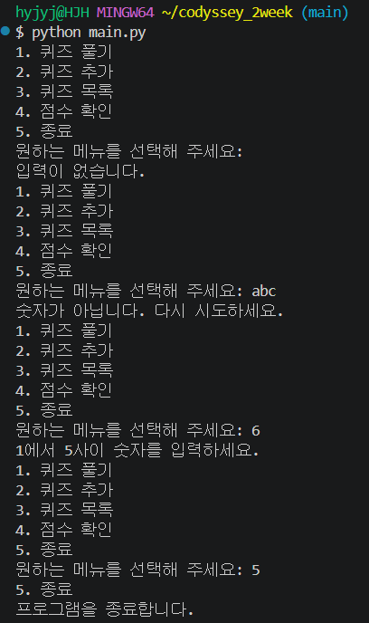

*그냥 Enter는 입력이 없습니다, abc는 숫자 아님, 6은 범위 안내, 5는 종료*

### break 옮기기

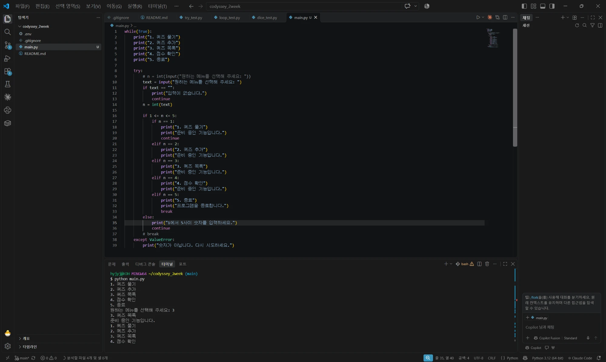

*break를 elif n == 5 안으로 옮기고 2~4번의 continue를 지운 main.py*

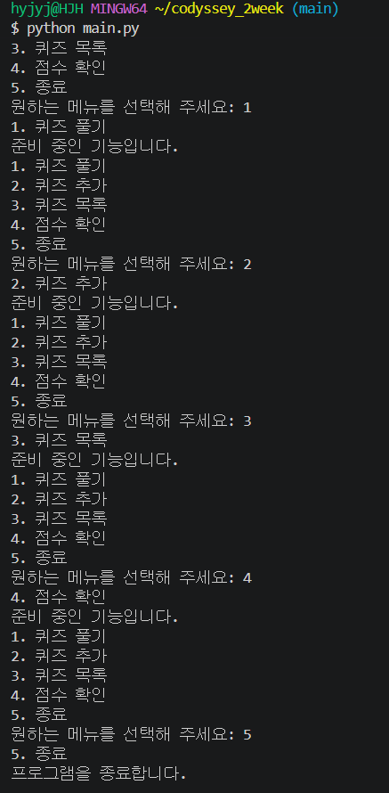

*1~4는 메뉴로 돌아가고 5에서만 끝난다*

### 정리하고 첫 기능 커밋

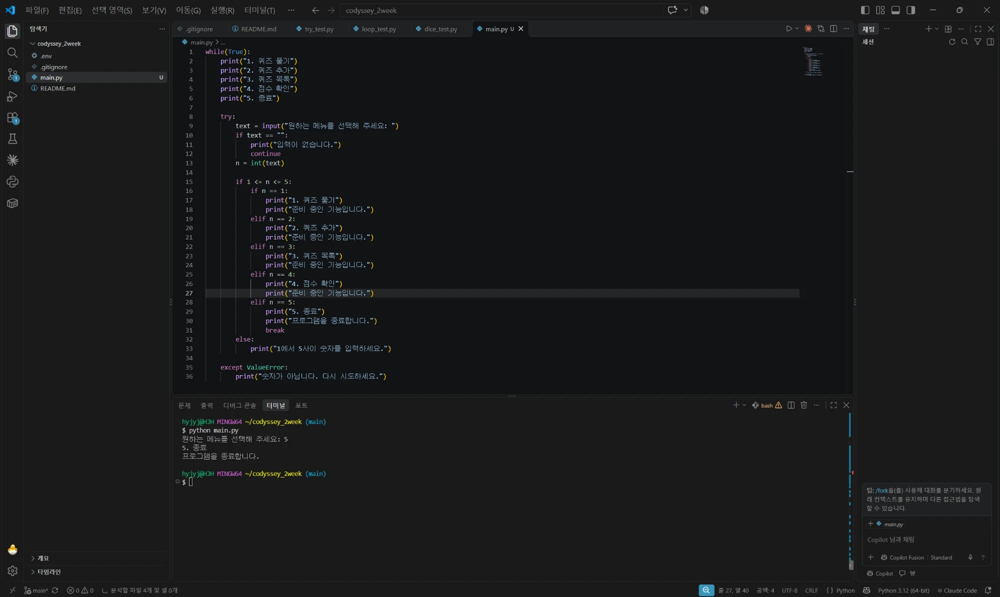

*정리한 main.py. continue는 빈 입력 아래 하나만 남았다*

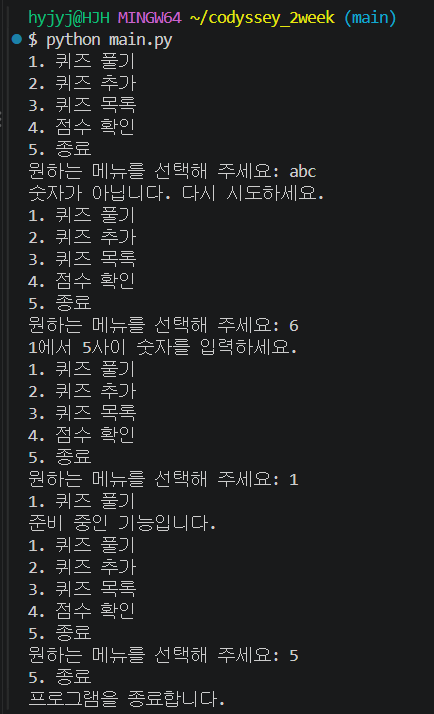

*정리 후 abc, 6, 1, 5가 이전과 같이 동작한다*

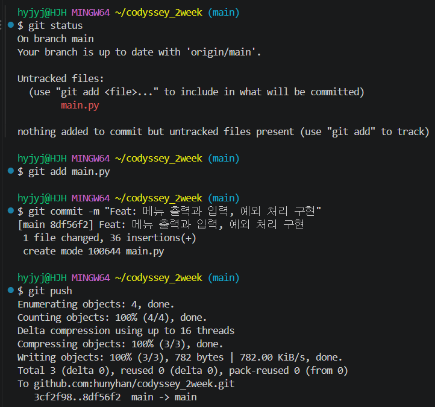

*git status에 main.py만 나오고, 8df56f2 Feat: 메뉴 출력과 입력, 예외 처리 구현을 커밋, 푸시*

## Quiz 클래스

### Person 실행

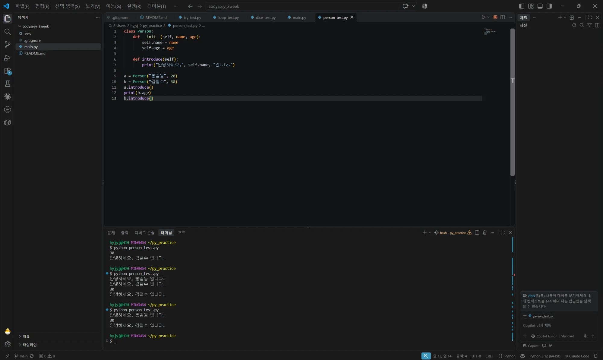

*person_test.py 실행. a.introduce()는 홍길동, b.introduce()는 김철수*

### Quiz 클래스를 한 단계씩 직접 쓰기

![자동완성으로 채워진 첫 quiz_test.py. choices 속성이 없고 get/set 메서드와 choices = ["1.", ..., "5."]가 있다](images/32-quiz-test-first.webp)

*자동완성으로 채워진 첫 quiz_test.py. choices 속성이 없고 get/set 메서드와 choices = ["1.", ..., "5."]가 있다*

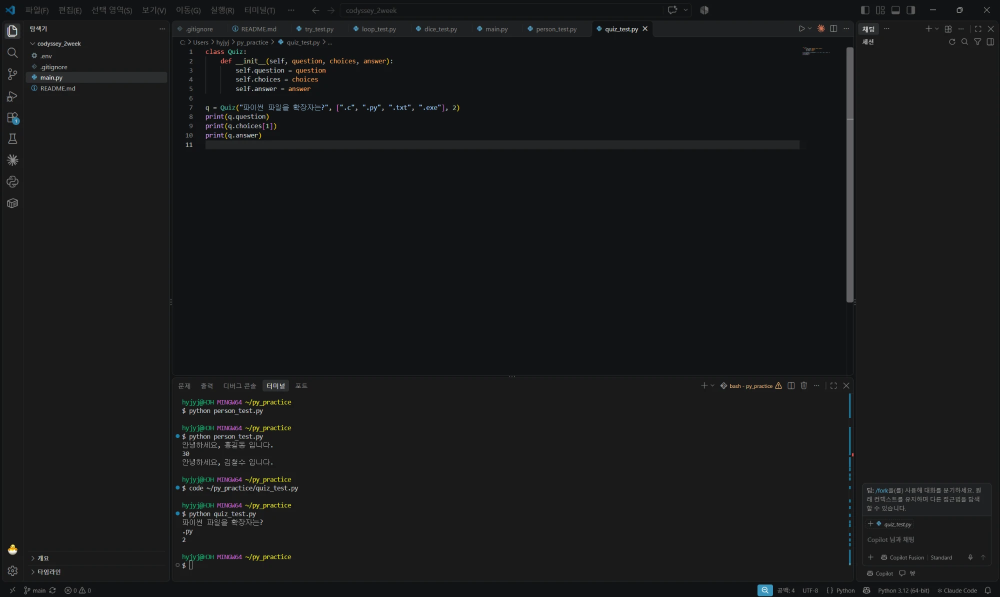

*직접 쓴 __init__과 실행 결과. 문제, .py, 2*

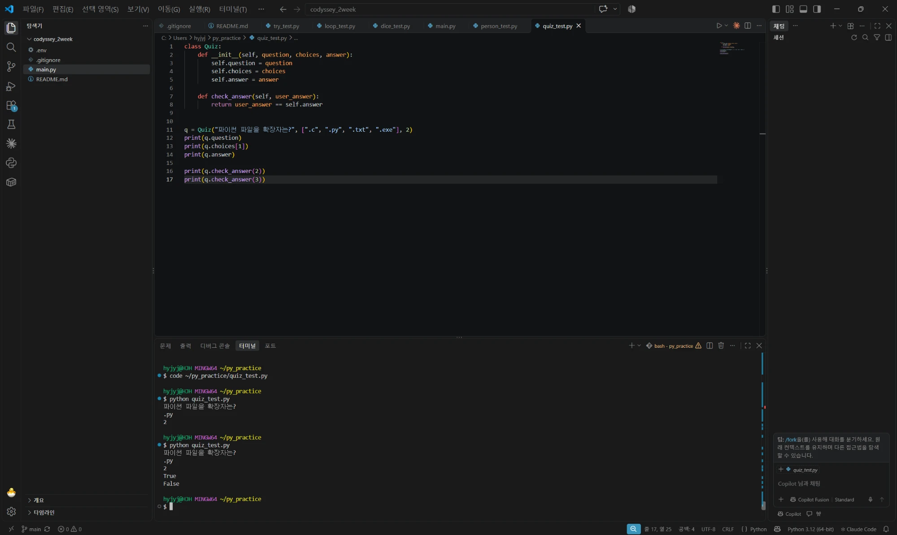

*직접 쓴 check_answer. 2는 True, 3은 False*

### 퀴즈 출력 메서드

![display_question이 {i + 1}. {self.choices[i]}를 글자 그대로 네 번 출력한다](images/32-quiz-display-braces.webp)

*display_question이 {i + 1}. {self.choices[i]}를 글자 그대로 네 번 출력한다*

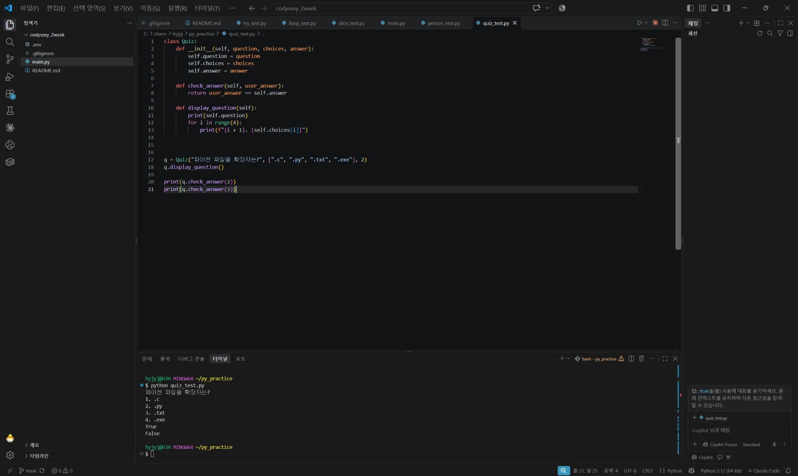

*f를 붙인 뒤 문제와 1. .c ~ 4. .exe가 바르게 출력된다*

### main.py에 넣고 커밋

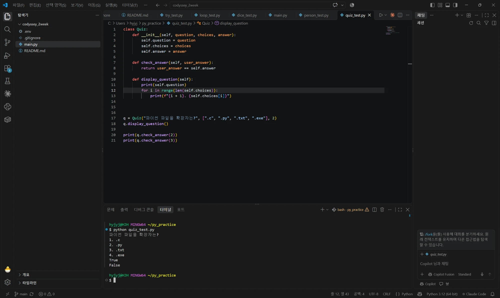

*range(len(self.choices))로 바꾼 quiz_test.py와 같은 결과*

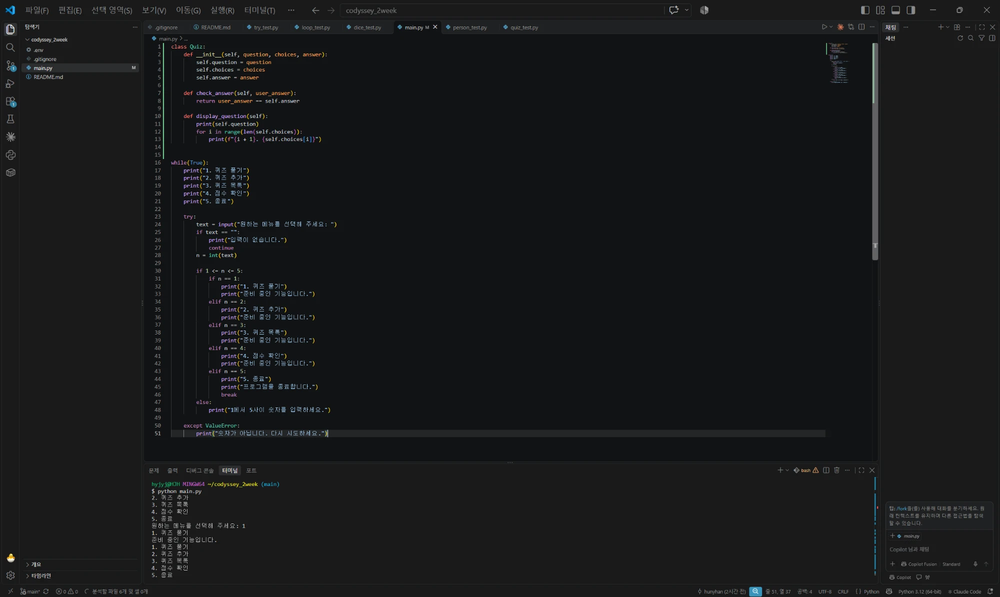

*main.py 맨 위에 Quiz 클래스, 아래에 기존 메뉴 코드*

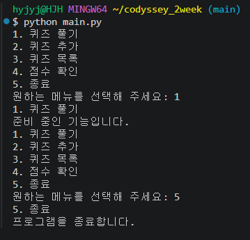

*클래스를 넣은 뒤에도 메뉴가 이전과 같이 동작한다*

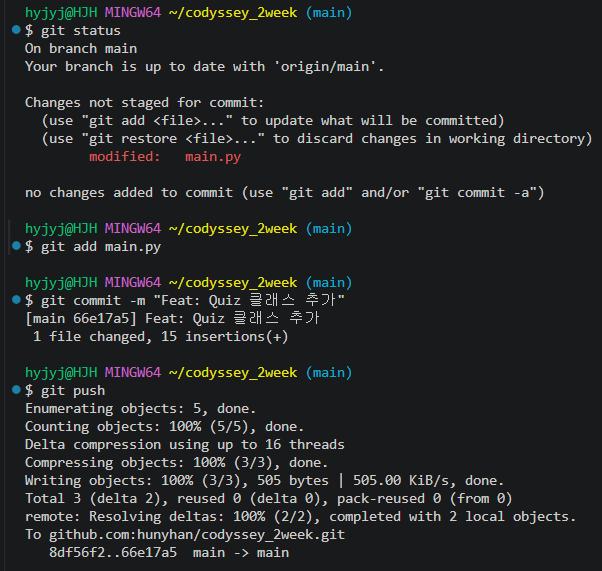

*git status는 modified: main.py, 66e17a5 Feat: Quiz 클래스 추가를 커밋, 푸시*
