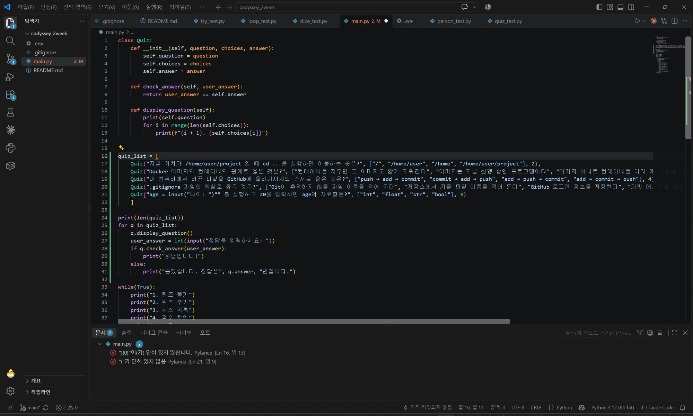
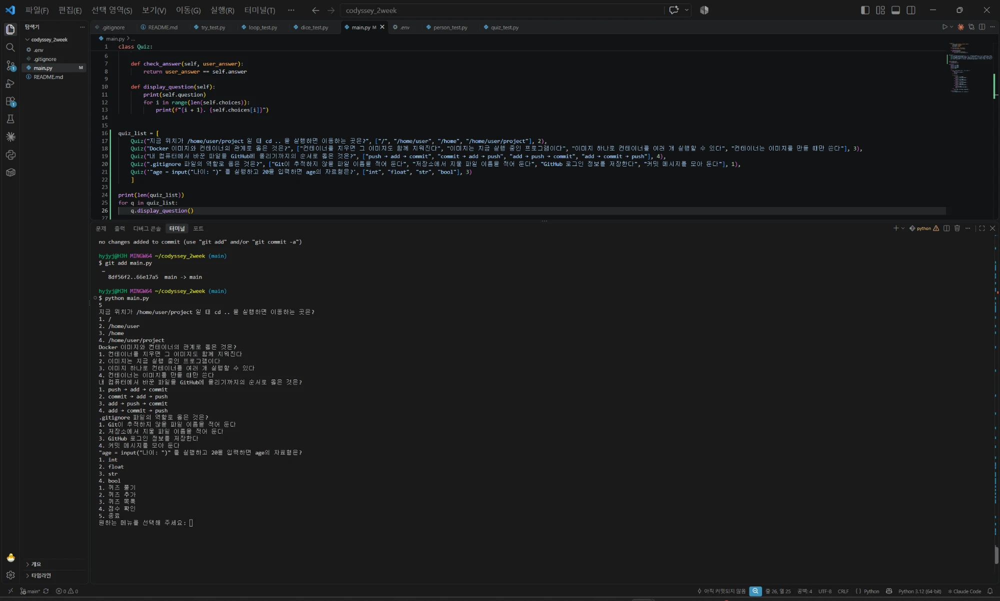
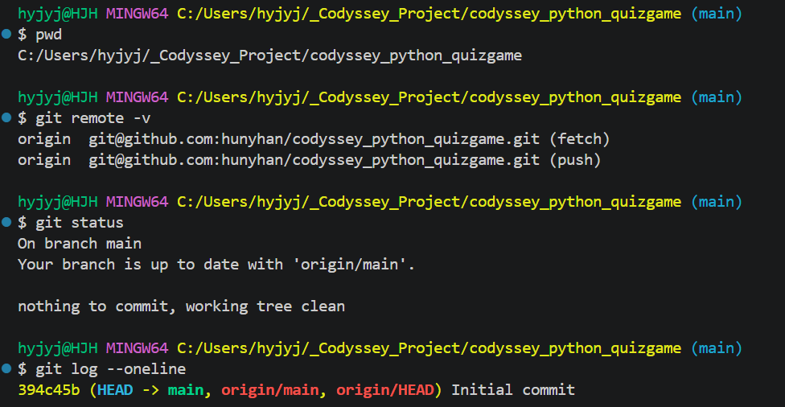
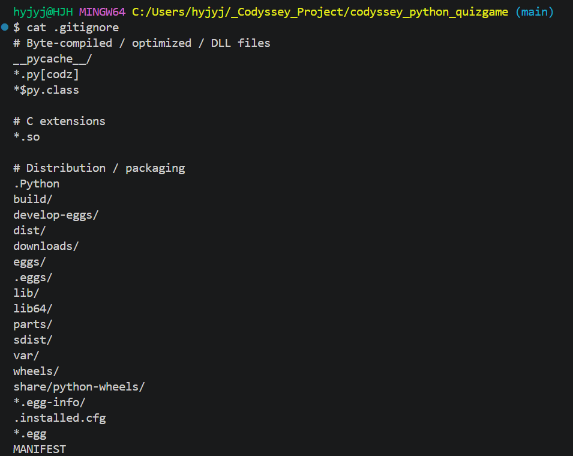
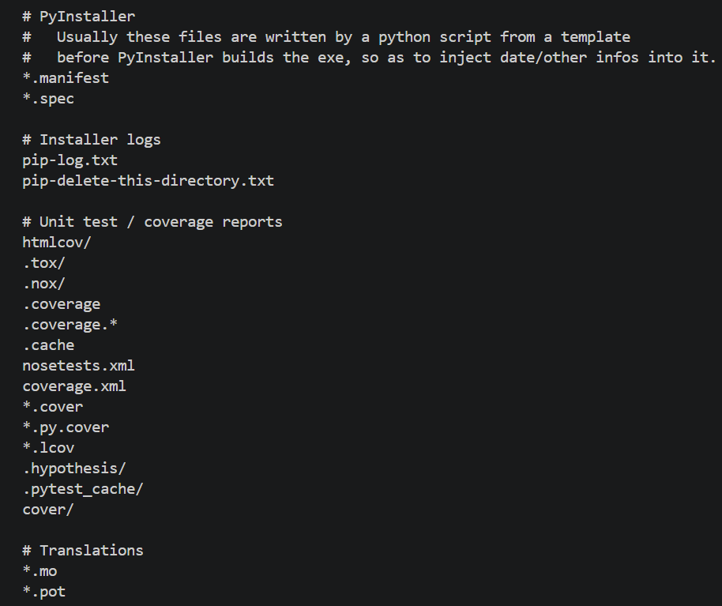
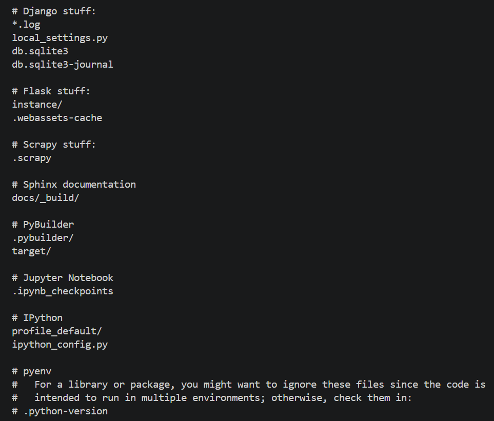
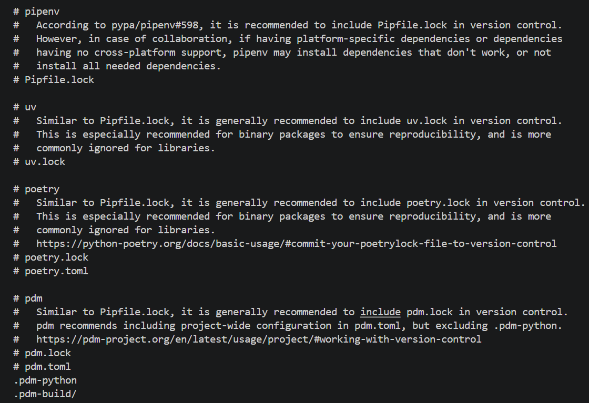
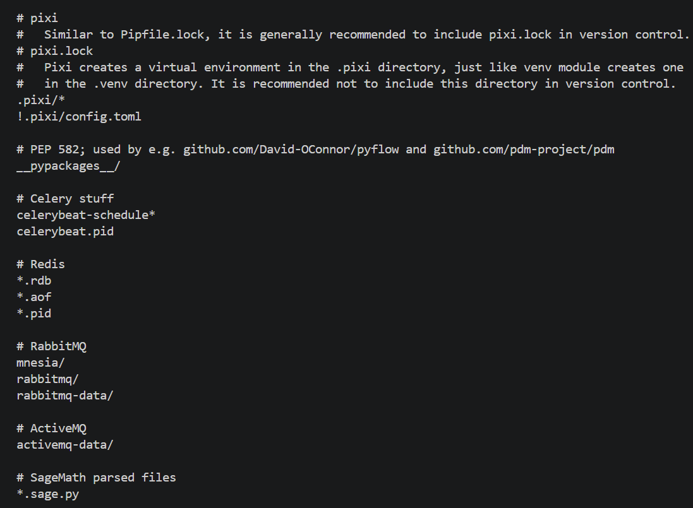
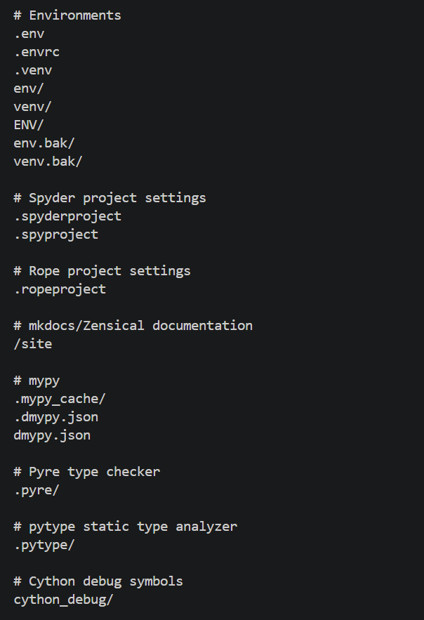
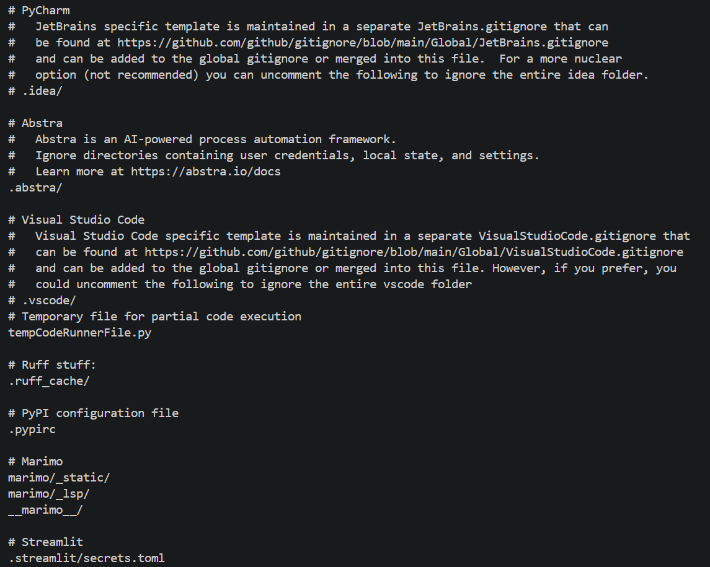

# 과제 저장소 만들기

[← README로 돌아가기](../README.md)

GitHub에서 Python용 `.gitignore`와 `README.md`를 넣어 새 저장소를 만들고 `git clone`으로 받았습니다. 기본 퀴즈 5개를 작성하며 따옴표 오류도 고쳤습니다.

## 퀴즈 5개를 main.py에 넣기

*quiz_list 21번째 줄에서 "(" 닫히지 않음, 16번째 줄에서 "[" 닫히지 않음 오류. 24~31번째 줄에 자동완성 풀기 코드가 있다*

*따옴표를 고친 뒤 len(quiz_list)는 5, 퀴즈 다섯 개가 모두 출력된다*

## 새 저장소에서 처음부터

*새 폴더 C:/Users/hyjyj/_Codyssey_Project/codyssey_python_quizgame, SSH 원격 주소, 깨끗한 상태, 394c45b Initial commit*

*GitHub Python용 .gitignore 1: __pycache__/ 등*

*GitHub Python용 .gitignore 2*

*GitHub Python용 .gitignore 3*

*GitHub Python용 .gitignore 4*

*GitHub Python용 .gitignore 5*

*GitHub Python용 .gitignore 6: .env, venv/ 등*

*GitHub Python용 .gitignore 7*
