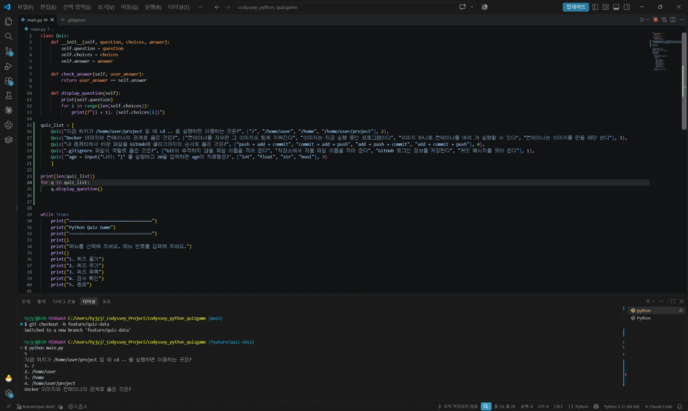
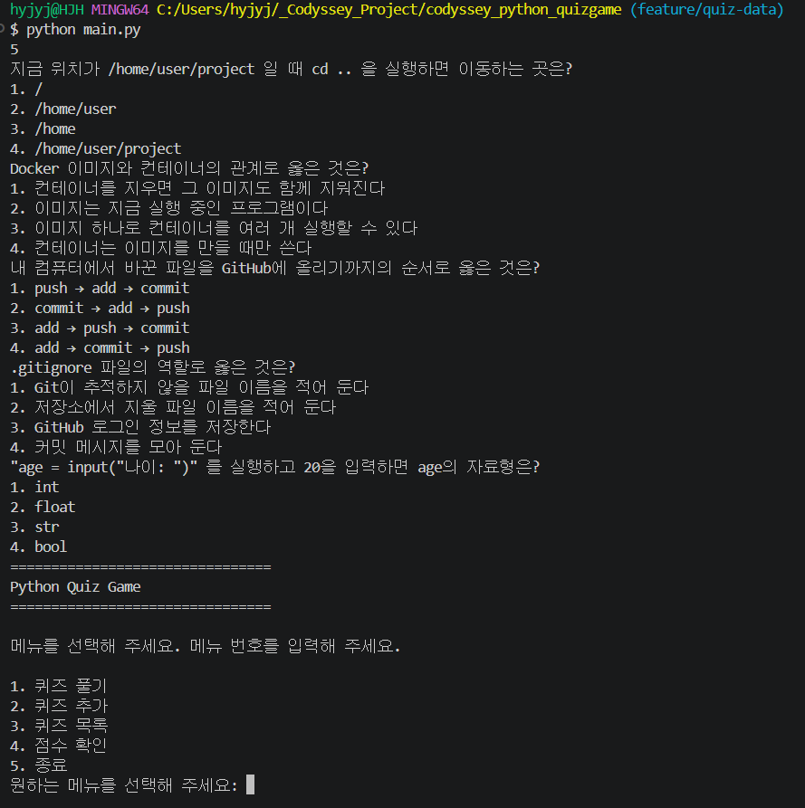
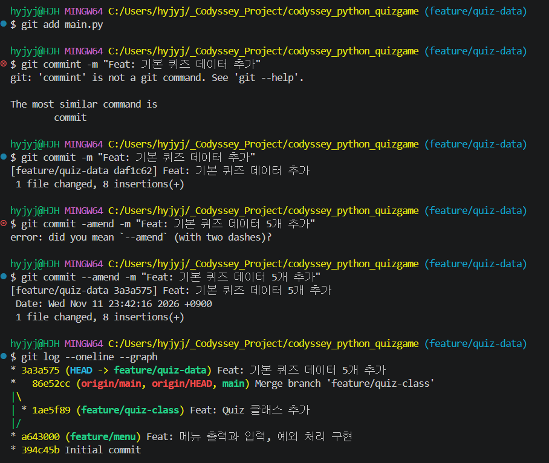
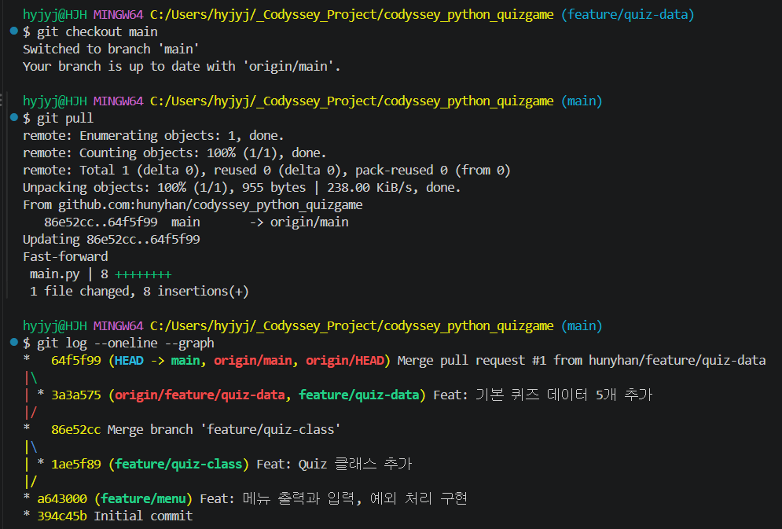
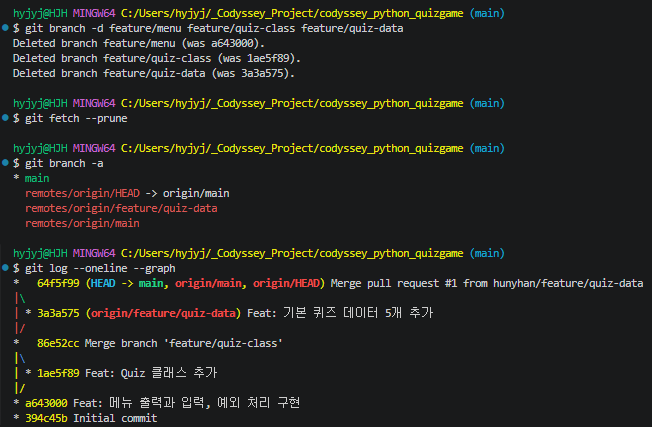

# 첫 Pull Request와 브랜치 정리

[← README로 돌아가기](../README.md)

기본 퀴즈 데이터를 `feature/quiz-data`에서 커밋하고 GitHub Pull Request #1로 합쳤습니다. 다 쓴 로컬·원격 브랜치를 지웠습니다.

## 퀴즈 데이터 브랜치에서 커밋하기

*quiz_list 다섯 개와 확인용 줄이 들어간 main.py*

*확인용 실행: 5와 퀴즈 다섯 문제 출력*

*커밋, git commint·-amend 오타를 Git 메시지 보고 고침, --amend로 메시지 다듬기, 그래프에서 feature/quiz-data가 main보다 한 칸 앞*

## 첫 Pull Request

*git checkout main, git pull로 86e52cc..64f5f99 Fast-forward, 그래프에 64f5f99 Merge pull request #1과 갈라진 줄 3a3a575*

## 다 쓴 브랜치 정리하기

*로컬 브랜치 3개 삭제(was a643000, 1ae5f89, 3a3a575), fetch --prune 출력 없음, branch -a에 remotes/origin/feature/quiz-data가 남음, 그래프는 그대로*

## GitHub에 남은 브랜치 지우기

![- [deleted] feature/quiz-data, branch -a에 main, origin/HEAD, origin/main만 남음](images/37-remote-branch-delete.png)

*- [deleted] feature/quiz-data, branch -a에 main, origin/HEAD, origin/main만 남음*
