# 퀴즈 풀기 (PR #2)

[← README로 돌아가기](../README.md)

퀴즈 풀기를 직접 작성했습니다. 잘못된 정답 입력을 같은 문제에서 다시 묻도록 네 번 고쳐 완성했고, 퀴즈가 없을 때의 안내도 확인했습니다.

## 브랜치 만들고 퀴즈 풀기 코드 쓰기

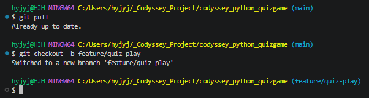

*feature/quiz-play 브랜치 만들기*

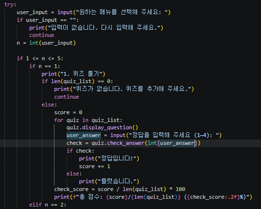

*퀴즈 풀기 첫 코드: 빈 목록 확인과 continue, score = 0, for, check_answer(int(user_answer)), 총점과 백분율*

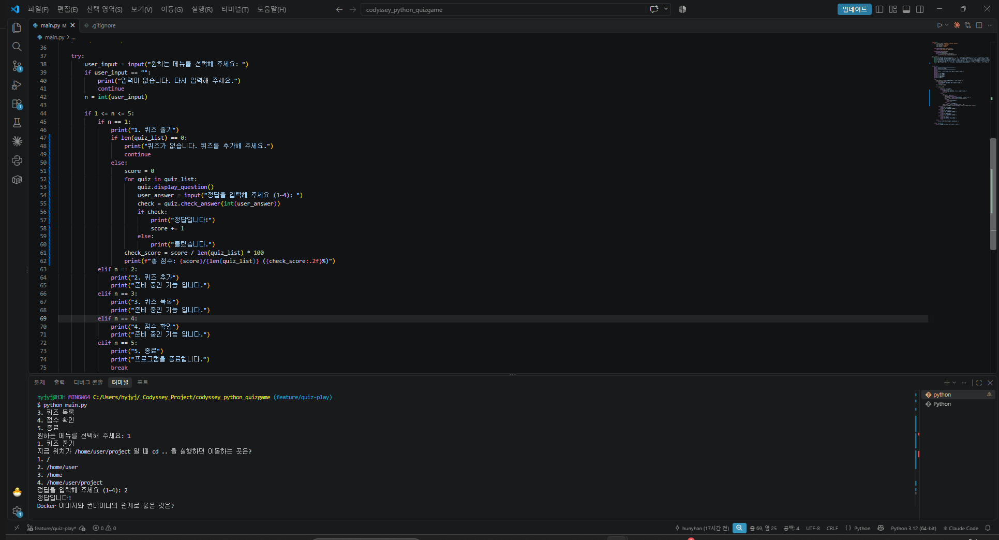

*첫 실행: 정답 3개, 5 입력은 오답 처리, 총 점수: 3/5 (60.00%)*

<details>
<summary>터미널 원문 (핵심 부분)</summary>

```text
.gitignore 파일의 역할로 옳은 것은?
...
정답을 입력해 주세요 (1~4): 5
틀렸습니다.
"age = input("나이: ")" 를 실행하고 20을 입력하면 age의 자료형은?
...
정답을 입력해 주세요 (1~4): 1
틀렸습니다.
총 점수: 3/5 (60.00%)
```

</details>

## 정답 입력을 다시 묻게 고치기

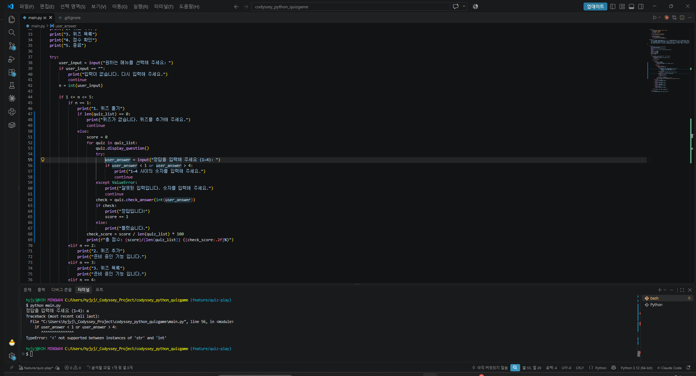

*첫 시도: while True 없이 try/except와 continue, 56번째 줄 if user_answer < 1 에서 TypeError: '<' not supported between instances of 'str' and 'int'*

## 다시 묻기 완성하기

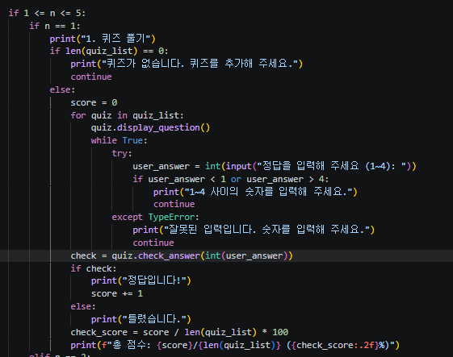

*두 번째 시도: while True와 int(input(...))는 들어갔지만 except TypeError, break 없음, check 줄이 for와 같은 칸*

## 세 번째 시도와 구조 설명

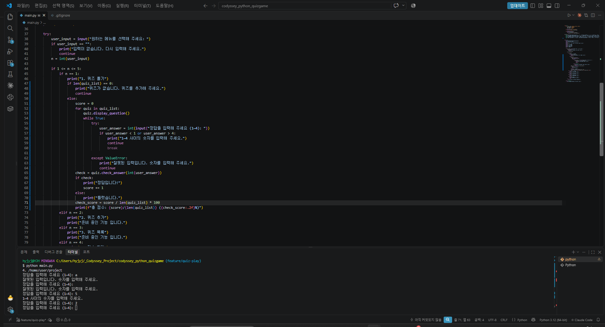

*세 번째 시도 실행: a, Enter, 5는 다시 묻지만 2를 넣어도 또 묻는다*

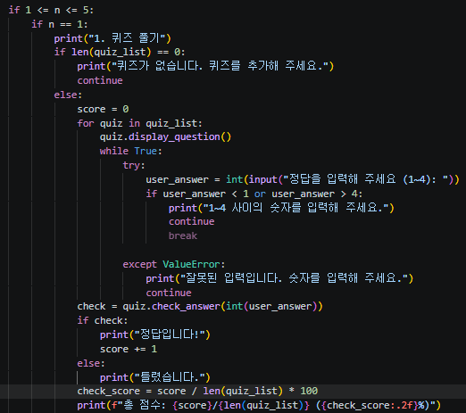

*세 번째 시도 코드: break가 if 안 continue 바로 아래에 있어 흐린 색*

<details>
<summary>터미널 원문 (핵심 부분)</summary>

```text
while True:
    try:
        user_answer = int(input("정답을 입력해 주세요 (1~4): "))
        if user_answer < 1 or user_answer > 4:
            print("1~4 사이의 숫자를 입력해 주세요.")
            continue
            break

    except ValueError:
        print("잘못된 입력입니다. 숫자를 입력해 주세요.")
        continue
```

</details>

## `2`를 넣었을 때 지나가는 줄

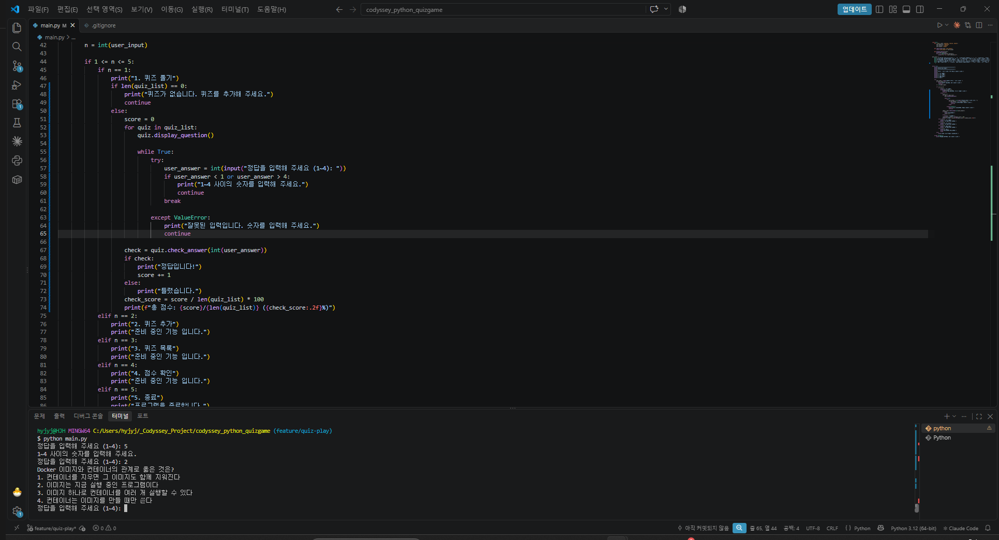

*네 번째 시도 실행: 2 다음 정답입니다!가 나오지 않고 바로 다음 문제로*

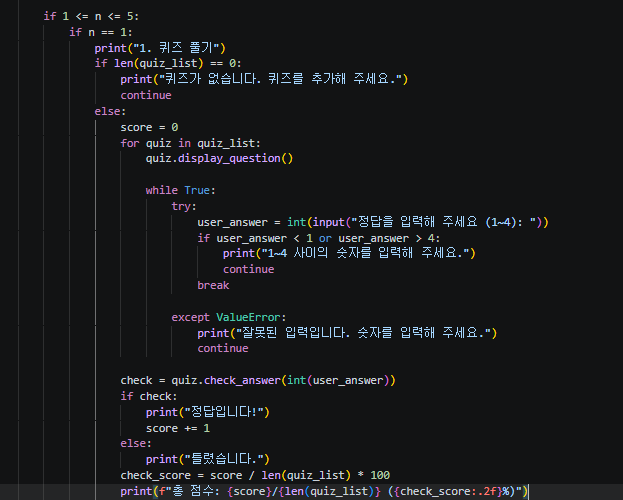

*네 번째 시도 코드: break는 if와 같은 칸으로 옮겨졌지만 check 줄이 아직 for와 같은 칸*

## check 줄의 칸

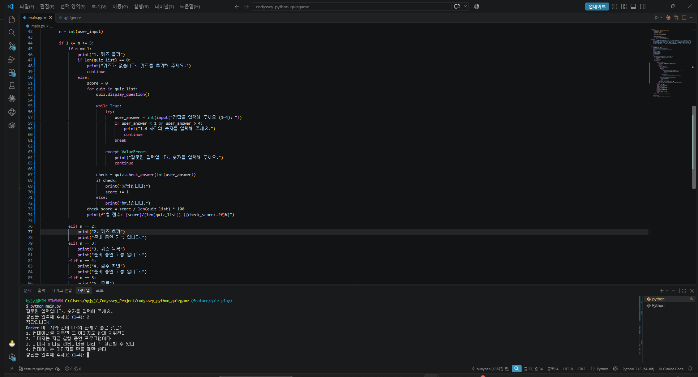

*완성 코드: while True 안에 try, int(input), 범위 if와 continue, if와 같은 칸의 break, except ValueError, while과 같은 칸의 check*

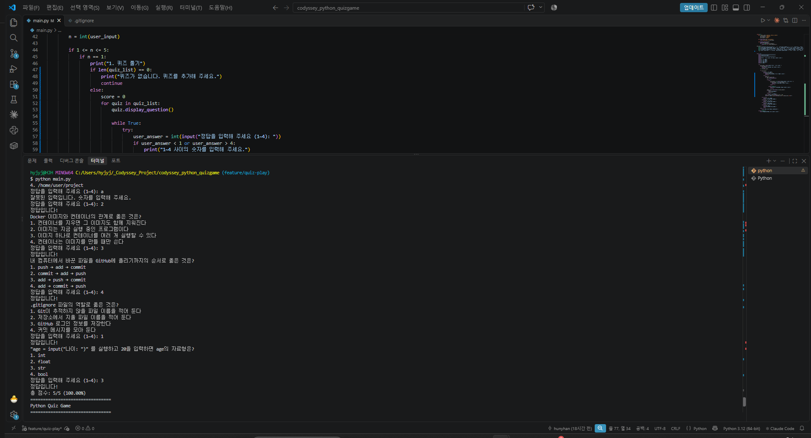

*완성 실행: a, Enter, 5는 다시 묻고 2에서 정답입니다!, 문제마다 정답/오답, 총 점수: 5/5 (100.00%)*

## 빈 목록 확인하기

![git diff 화면: 15번째 줄이 quiz_list = [][로 바뀌었고 맨 아래 :에서 멈춤](images/38-empty-test-diff-pager.png)

*git diff 화면: 15번째 줄이 quiz_list = [][로 바뀌었고 맨 아래 :에서 멈춤*

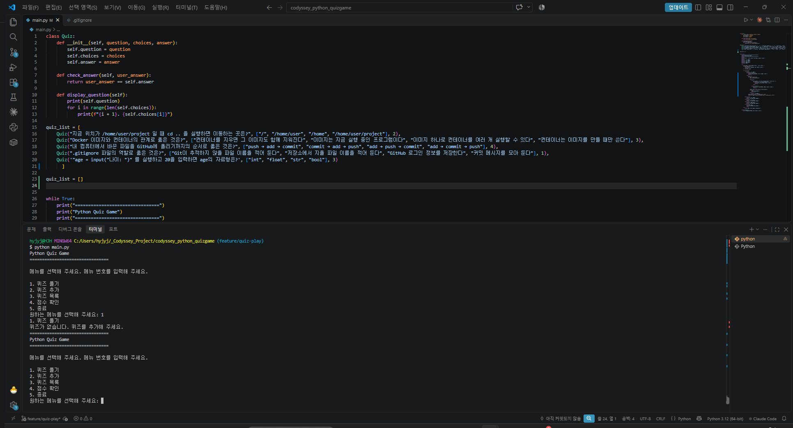

*빈 목록 실행: 1을 고르자 퀴즈가 없습니다. 퀴즈를 추가해 주세요. 후 메뉴로*

![확인용 줄을 지우기 전 git diff: ] 앞 공백 4칸→6칸, 빈 줄 하나, quiz_list = []](images/38-empty-list-diff.png)

*확인용 줄을 지우기 전 git diff: ] 앞 공백 4칸→6칸, 빈 줄 하나, quiz_list = []*

![되돌린 뒤 git diff: 확인용 줄과 빈 줄은 사라졌고 ] 줄만 4칸→6칸으로 남음](images/38-restore-diff.png)

*되돌린 뒤 git diff: 확인용 줄과 빈 줄은 사라졌고 ] 줄만 4칸→6칸으로 남음*

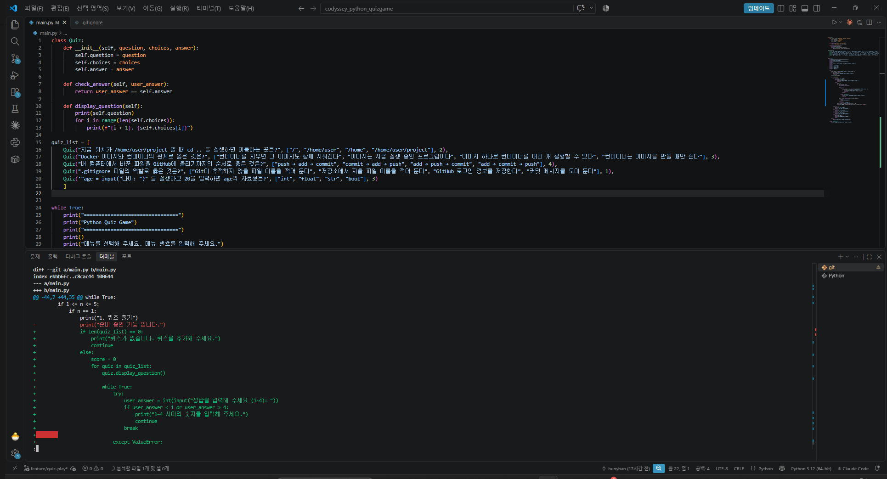

*공백을 맞춘 뒤 git diff: 맨 위가 @@ -44,7 +44,35 @@ while True:로 시작, 퀴즈 풀기 변경만 남음*

## 커밋하고 PR #2로 합치기

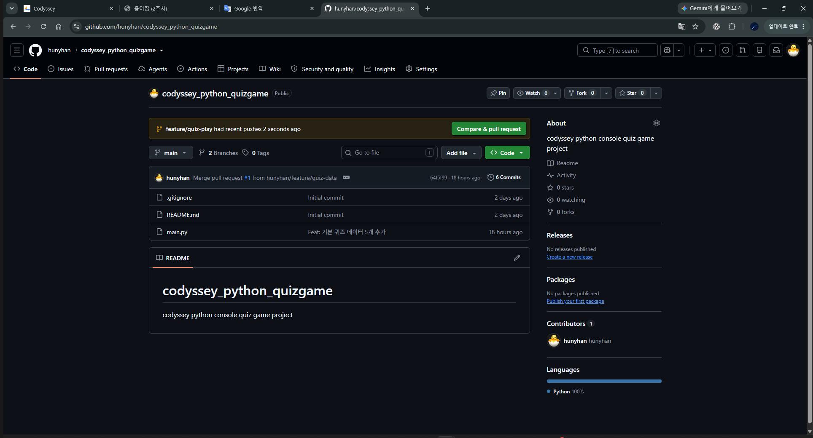

*저장소 첫 화면: feature/quiz-play had recent pushes, Compare & pull request 버튼*

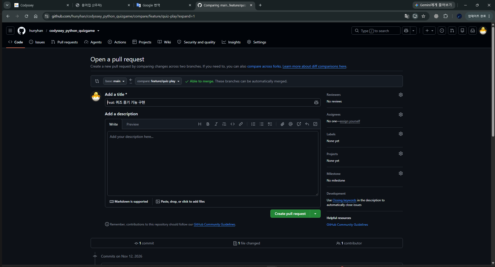

*PR 만들기: base: main ← compare: feature/quiz-play, Able to merge, 제목 Feat: 퀴즈 풀기 기능 구현*

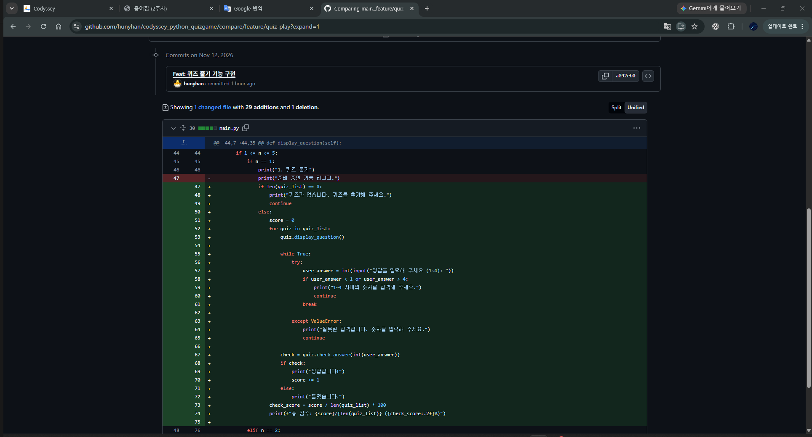

*PR 만들기 아래쪽: 커밋 a892eb0, 1 changed file with 29 additions and 1 deletion*

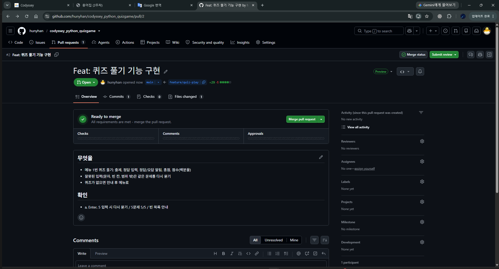

*PR #2 Open: Ready to merge, 설명 무엇을/확인*

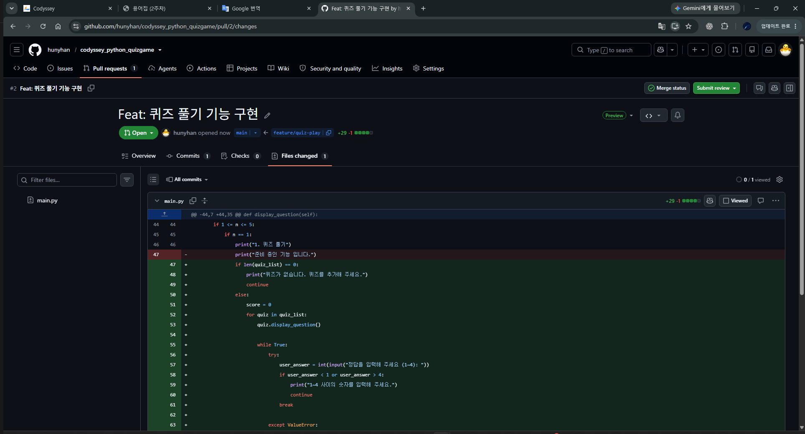

*PR #2 Files changed: main.py +29 -1, 준비 중인 기능 줄이 빨강, 퀴즈 풀기 코드가 초록*

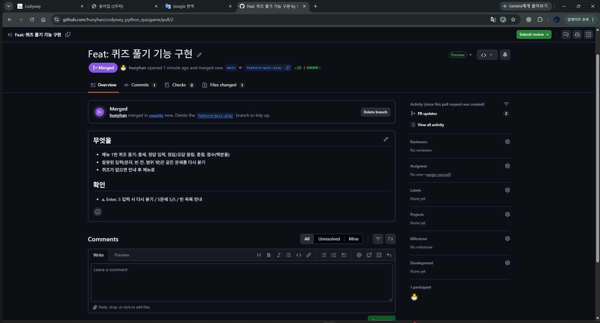

*PR #2 Merged: merged in eaba98d, Delete branch 버튼*

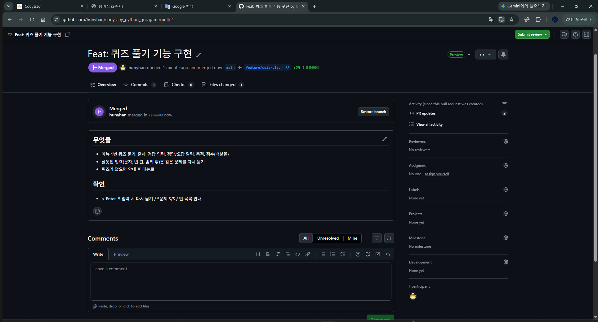

*Delete branch를 누른 뒤: 버튼이 Restore branch로 바뀜*

<details>
<summary>터미널 원문 (핵심 부분)</summary>

```text
$ git pull
   64f5f99..eaba98d  main       -> origin/main
Updating 64f5f99..eaba98d
Fast-forward
 main.py | 30 +++++++++++++++++++++++++++++-
 1 file changed, 29 insertions(+), 1 deletion(-)
$ git branch -d feature/quiz-play
Deleted branch feature/quiz-play (was a892eb0).
$ git fetch --prune
From github.com:hunyhan/codyssey_python_quizgame
 - [deleted]         (none)     -> origin/feature/quiz-play
$ git log --oneline --graph
*   eaba98d (HEAD -> main, origin/main, origin/HEAD) Merge pull request #2 from hunyhan/feature/quiz-play
|\
| * a892eb0 Feat: 퀴즈 풀기 기능 구현
|/
*   64f5f99 Merge pull request #1 from hunyhan/feature/quiz-data
...
```

</details>

![터미널: branch -d, fetch --prune의 - [deleted] origin/feature/quiz-play, 그래프에 eaba98d와 a892eb0](images/38-pr2-pull-graph.png)

*터미널: branch -d, fetch --prune의 - [deleted] origin/feature/quiz-play, 그래프에 eaba98d와 a892eb0*
