# 퀴즈 추가 (PR #3)

[← README로 돌아가기](../README.md)

문제, 선택지 4개, 정답 번호를 입력받아 퀴즈를 추가합니다. 숫자 입력은 "입력 받기 → 빈 칸 검사 → `int()`" 순서가 맞다는 것을 실행으로 확인했습니다.

## 브랜치 만들고 퀴즈 추가 코드 쓰기

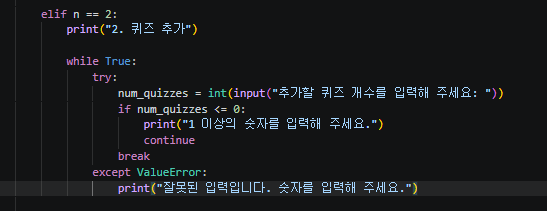

*첫 시도: 문제 대신 추가할 퀴즈 개수를 int로 받고 0 이하·숫자 아님을 거르는 while True*

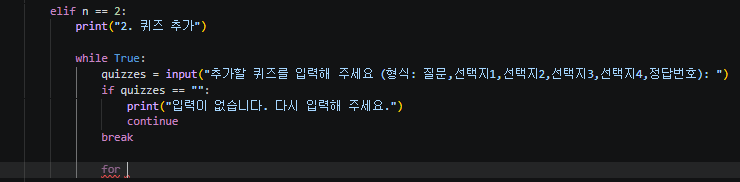

*두 번째 시도: 한 줄에 질문,선택지1~4,정답번호를 받는 문구와, while 안 break 아래에 들어간 for*

## 선택지를 4번 받는 for

![선택지 코드: for 앞 choices = [], for i in range(4), 안에 while True와 빈 칸 검사, append 후 break](images/39-quiz-add-choices.png)

*선택지 코드: for 앞 choices = [], for i in range(4), 안에 while True와 빈 칸 검사, append 후 break*

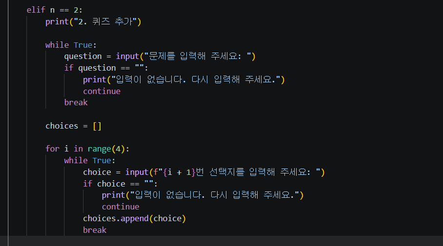

*변수 이름을 quizzes에서 question으로 바꾼 화면*

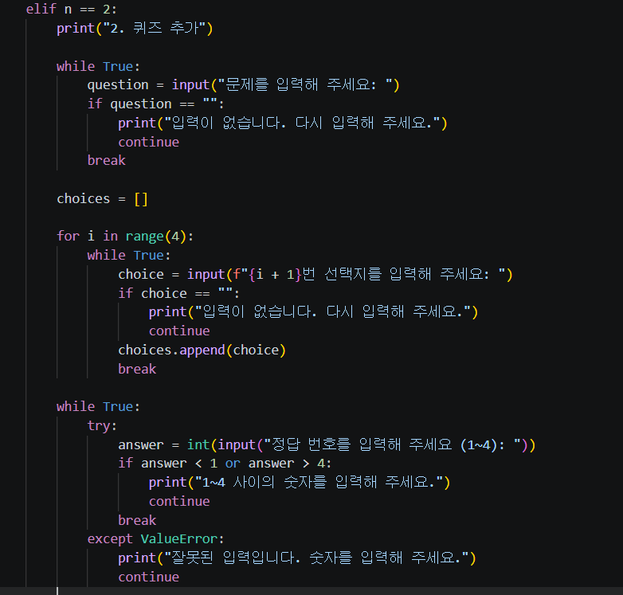

*정답 번호 첫 시도: int(input())을 바로 쓰고 범위 if, except ValueError. 빈 칸 검사 없음*

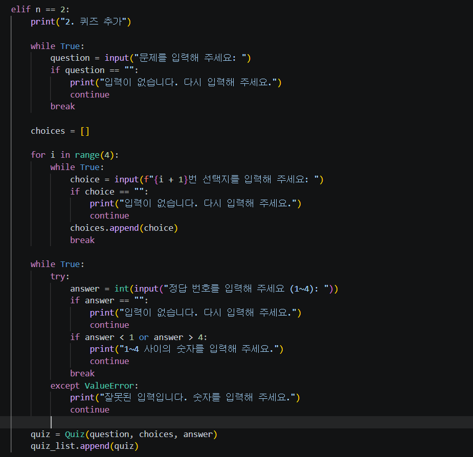

*빈 칸 검사를 int(input()) 다음 줄에 넣은 화면. Quiz 만들기와 quiz_list.append도 추가됨*

## 빈 칸 검사를 int() 다음에 두면

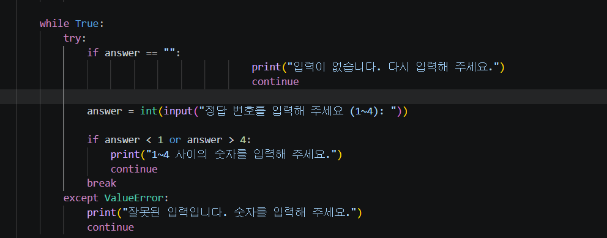

*순서를 고치려다 들여쓰기가 틀어진 화면: if answer == "" 가 위로 올라감, print와 continue가 오른쪽으로 밀림*

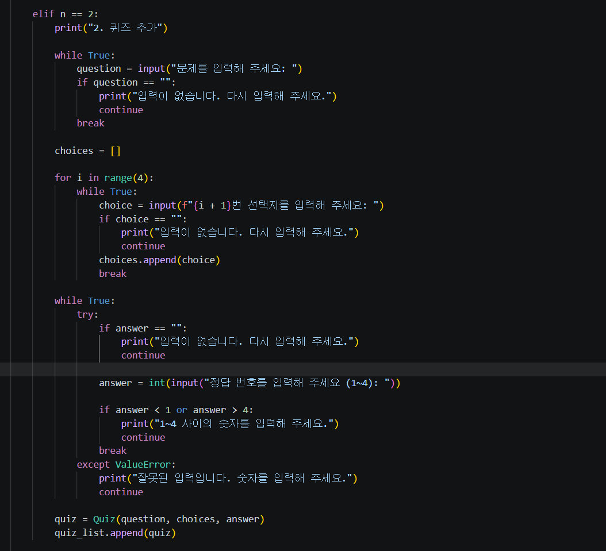

*들여쓰기는 맞췄지만 if answer == "" 가 여전히 answer = int(input(...)) 위에 있는 화면*

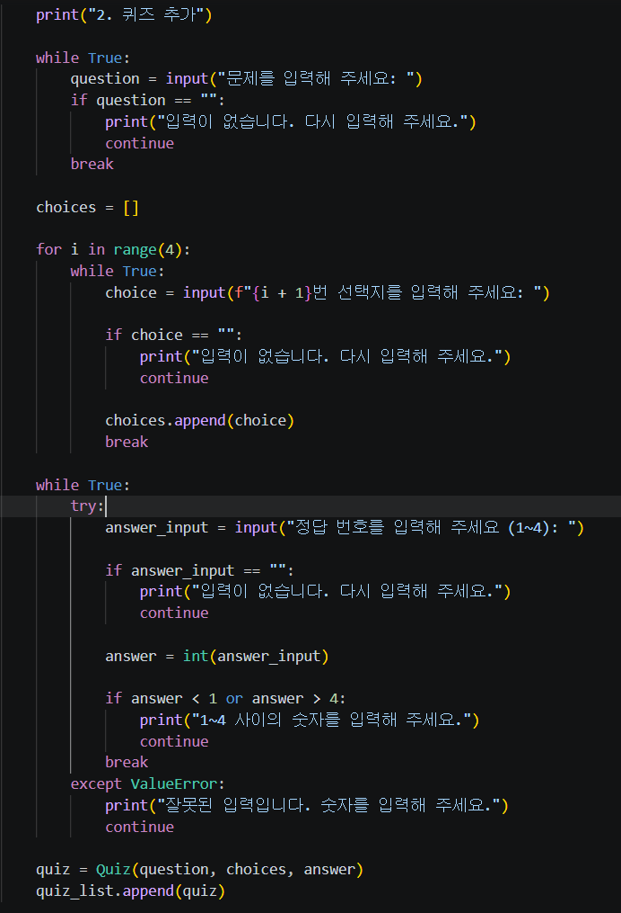

*순서를 고친 정답 번호 코드: answer_input = input → if answer_input == "" → answer = int(answer_input) → 범위 if → break*

<details>
<summary>터미널 원문 (핵심 부분)</summary>

```text
$ python main.py
원하는 메뉴를 선택해 주세요: 1
...
총 점수: 1/5 (20.00%)
원하는 메뉴를 선택해 주세요: 2
2. 퀴즈 추가
문제를 입력해 주세요: 파이썬 파일 확장자는?
1번 선택지를 입력해 주세요:
입력이 없습니다. 다시 입력해 주세요.
1번 선택지를 입력해 주세요: .py
2번 선택지를 입력해 주세요: .txt
3번 선택지를 입력해 주세요: .java
4번 선택지를 입력해 주세요: .c
정답 번호를 입력해 주세요 (1~4):
입력이 없습니다. 다시 입력해 주세요.
정답 번호를 입력해 주세요 (1~4): abc
잘못된 입력입니다. 숫자를 입력해 주세요.
정답 번호를 입력해 주세요 (1~4): 7
1~4 사이의 숫자를 입력해 주세요.
정답 번호를 입력해 주세요 (1~4): 1
퀴즈가 추가되었습니다.
원하는 메뉴를 선택해 주세요: 1
...
파이썬 파일 확장자는?
1. .py
2. .txt
3. .java
4. .c
정답을 입력해 주세요 (1~4): 1
정답입니다!
총 점수: 2/6 (33.33%)
```

</details>

## push하고 PR #3 만들기

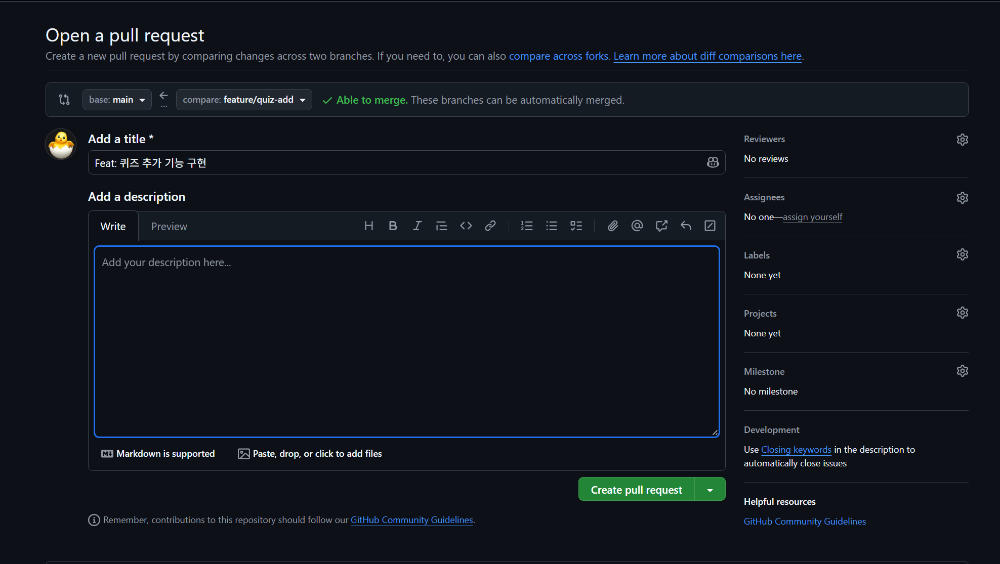

*PR #3 만들기 화면: base main ← compare feature/quiz-add, Able to merge, 제목 Feat: 퀴즈 추가 기능 구현, 설명 비어 있음*

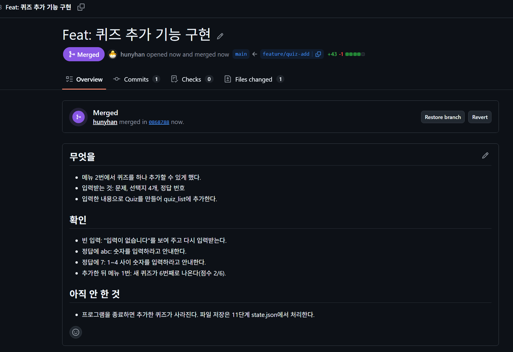

*PR #3 Merged: merged in 0868788, +43 -1, Restore branch 버튼, 무엇을/확인/아직 안 한 것 설명*

## 내 컴퓨터 정리

<details>
<summary>터미널 원문 (핵심 부분)</summary>

```text
$ git pull
   eaba98d..0868788  main       -> origin/main
Fast-forward
 1 file changed, 43 insertions(+), 1 deletion(-)
$ git branch -d feature/quiz-add
Deleted branch feature/quiz-add (was 053c61f).
$ git fetch --prune
 - [deleted]         (none)     -> origin/feature/quiz-add
$ git log --oneline --graph
*   0868788 (HEAD -> main, origin/main, origin/HEAD) Merge pull request #3 from hunyhan/feature/quiz-add
|\
| * 053c61f Feat: 퀴즈 추가 기능 구현
|/
*   eaba98d Merge pull request #2 from hunyhan/feature/quiz-play
...
```

</details>

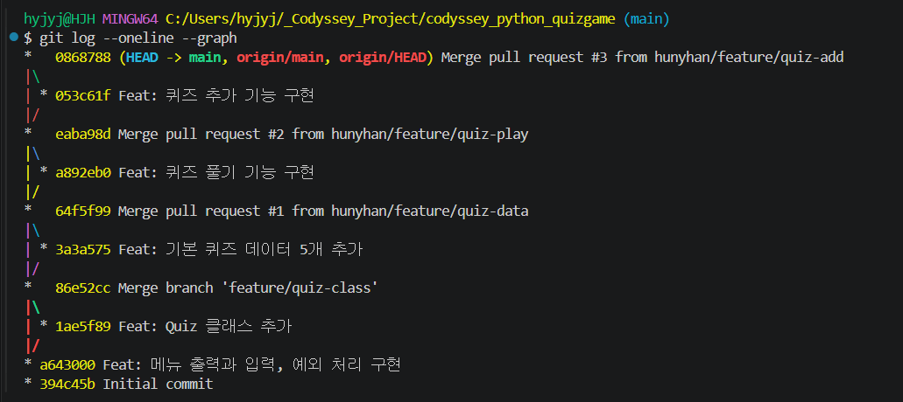

*색이 있는 그래프: 맨 위 0868788 Merge pull request #3, 053c61f가 갈라졌다 합쳐짐, 아래로 PR #2, PR #1, quiz-class*
