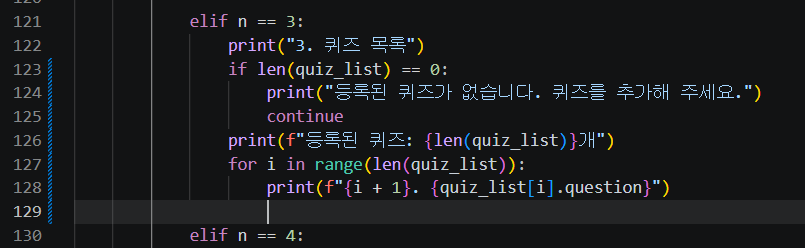
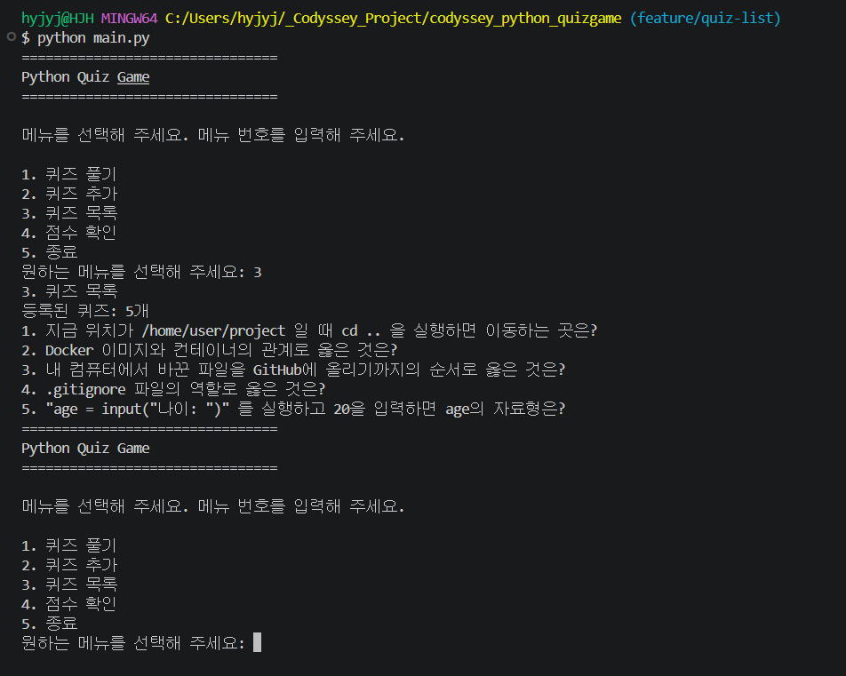
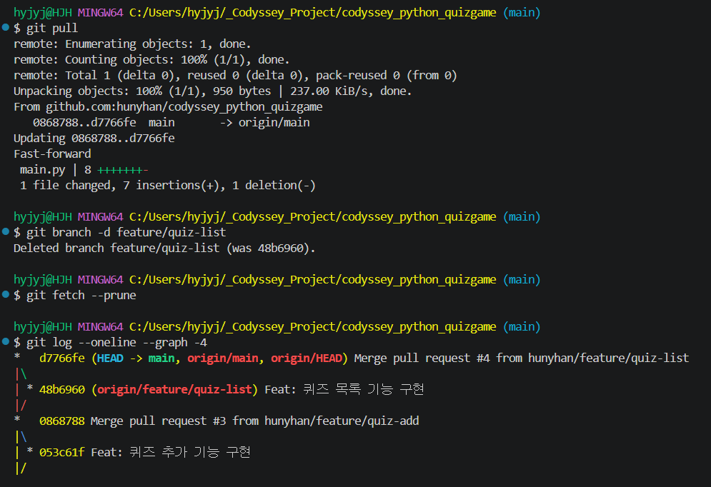

# 퀴즈 목록과 점수 확인 (PR #4, #5)

[← README로 돌아가기](../README.md)

등록된 퀴즈 목록 보기와 최고 점수 확인·갱신을 추가했습니다.

## 퀴즈 목록과 네 번째 Pull Request

### 정답 코드 입력과 PR #4



*메뉴 3번 코드 121~128번째 줄*



*실행: 메뉴 3 → 등록된 퀴즈: 5개와 문제 5줄*

<details>
<summary>터미널 원문 (핵심 부분)</summary>

```text
$ git diff
-                print("준비 중인 기능 입니다.")
+                if len(quiz_list) == 0:
...
+                    print(f"{i + 1}. {quiz_list[i].question}")
$ git commit -m "Feat: 퀴즈 목록 기능 구현"
[feature/quiz-list 48b6960] Feat: 퀴즈 목록 기능 구현
 1 file changed, 7 insertions(+), 1 deletion(-)
$ git push -u origin feature/quiz-list
 * [new branch]      feature/quiz-list -> feature/quiz-list
branch 'feature/quiz-list' set up to track 'origin/feature/quiz-list'.
$ git checkout main
$ git pull
   0868788..d7766fe  main       -> origin/main
Fast-forward
 1 file changed, 7 insertions(+), 1 deletion(-)
$ git branch -d feature/quiz-list
Deleted branch feature/quiz-list (was 48b6960).
$ git fetch --prune
$ git log --oneline --graph -4
*   d7766fe (HEAD -> main, origin/main, origin/HEAD) Merge pull request #4 from hunyhan/feature/quiz-list
|\
| * 48b6960 (origin/feature/quiz-list) Feat: 퀴즈 목록 기능 구현
|/
...
```

</details>



*git pull, branch -d, fetch --prune(출력 없음), 그래프에 origin/feature/quiz-list가 남음*

### GitHub 쪽 브랜치 지우기

![push origin --delete로 - [deleted] feature/quiz-list, 그래프에서 origin/feature/quiz-list 표시가 사라짐](images/40-remote-branch-delete.png)

*push origin --delete로 - [deleted] feature/quiz-list, 그래프에서 origin/feature/quiz-list 표시가 사라짐*

## 최고 점수 확인과 다섯 번째 Pull Request

### 정답 코드 입력과 PR #5

<details>
<summary>터미널 원문 (핵심 부분)</summary>

```text
원하는 메뉴를 선택해 주세요: 4
아직 퀴즈를 푼 기록이 없습니다. 먼저 퀴즈를 풀어 주세요.
원하는 메뉴를 선택해 주세요: 1
...
총 점수: 1/5 (20.00%)
최고 점수를 갱신했습니다!
원하는 메뉴를 선택해 주세요: 4
최고 점수: 20.00%
원하는 메뉴를 선택해 주세요: 1
...
총 점수: 0/5 (0.00%)
원하는 메뉴를 선택해 주세요: 4
최고 점수: 20.00%
원하는 메뉴를 선택해 주세요: 1
...
총 점수: 5/5 (100.00%)
최고 점수를 갱신했습니다!
원하는 메뉴를 선택해 주세요: 4
최고 점수: 100.00%
원하는 메뉴를 선택해 주세요: 5
프로그램을 종료합니다.
$ git commit -m "Feat: 최고 점수 확인 기능 구현"
[feature/score b896279] Feat: 최고 점수 확인 기능 구현
 1 file changed, 9 insertions(+), 1 deletion(-)
$ git pull
   d7766fe..e98bc3e  main       -> origin/main
Fast-forward
$ git branch -d feature/score
Deleted branch feature/score (was b896279).
$ git fetch --prune
 - [deleted]         (none)     -> origin/feature/score
```

</details>

![branch -d, fetch --prune의 - [deleted] origin/feature/score, 그래프 맨 위 e98bc3e Merge pull request #5](images/41-pr5-pull-graph.png)

*branch -d, fetch --prune의 - [deleted] origin/feature/score, 그래프 맨 위 e98bc3e Merge pull request #5*
