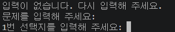
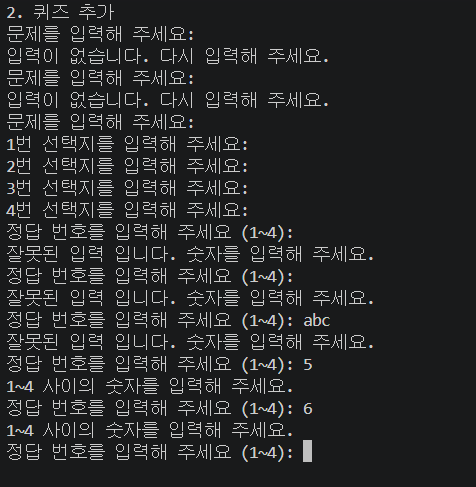
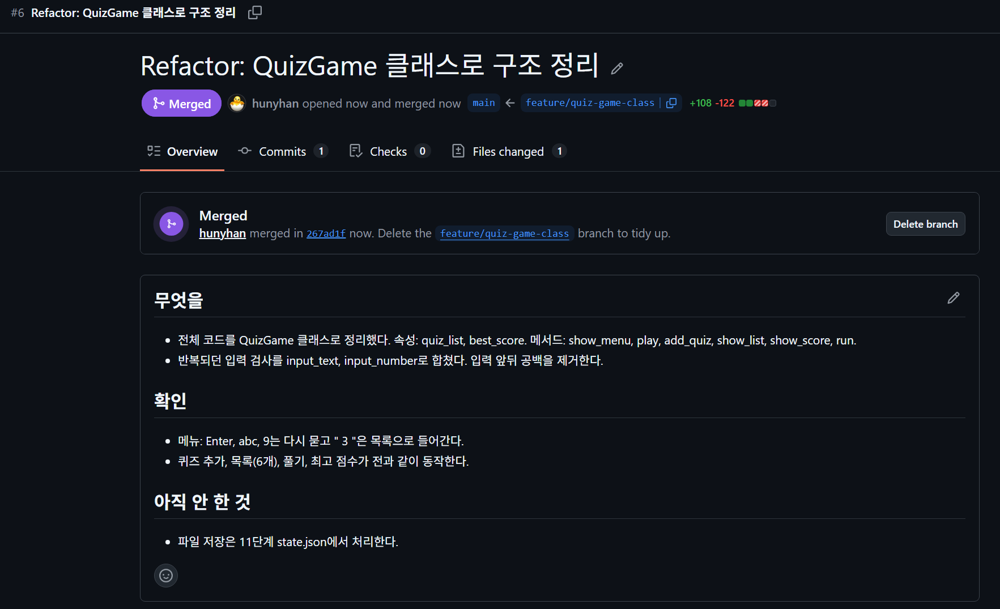
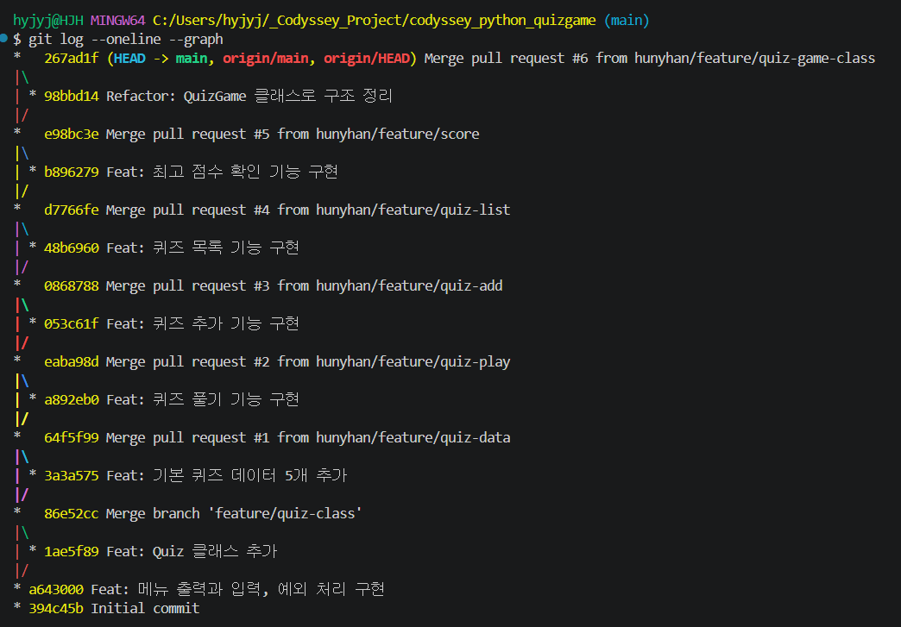
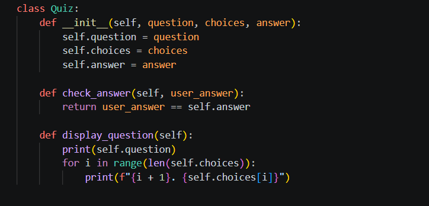
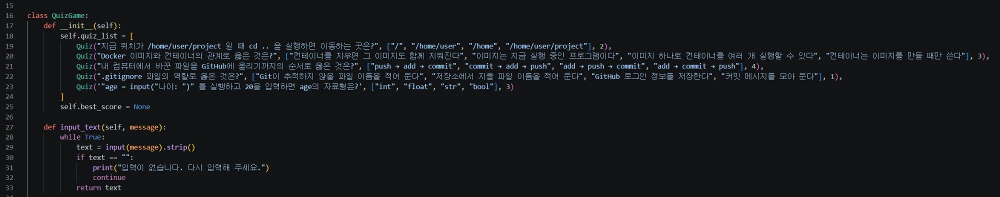
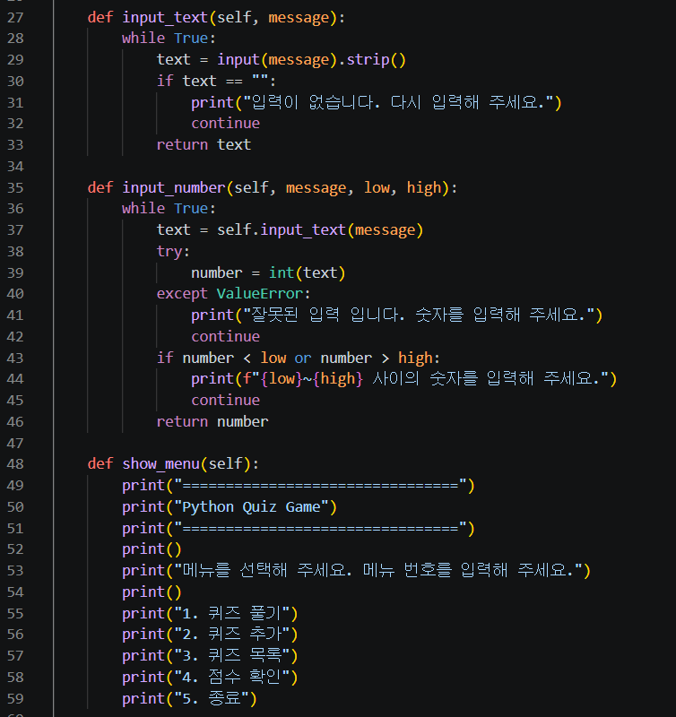
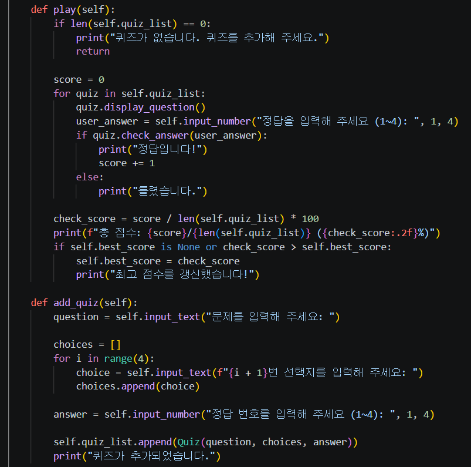
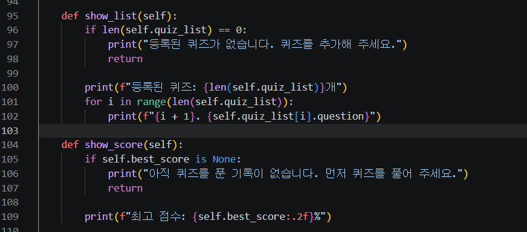
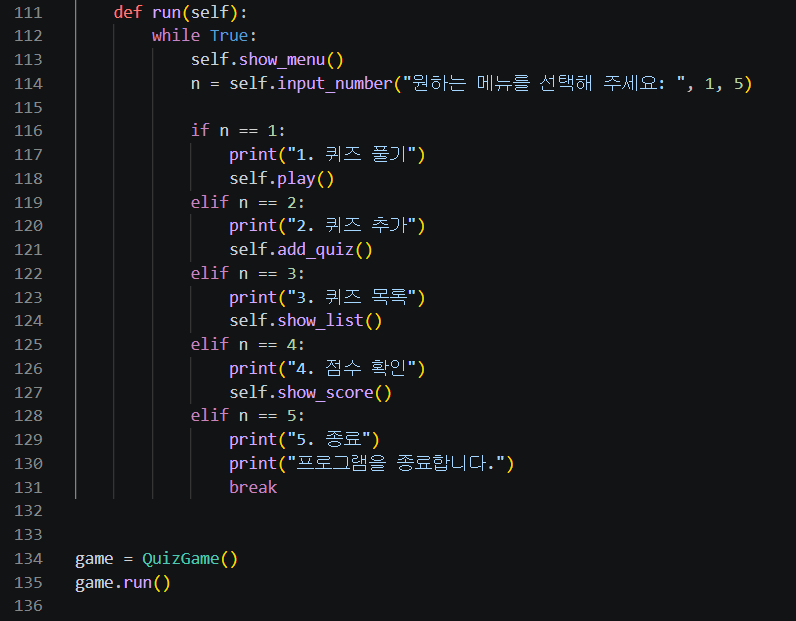

# QuizGame 클래스로 구조 정리 (PR #6)

[← README로 돌아가기](../README.md)

기능을 `QuizGame` 클래스의 속성과 메서드로 나누고, 반복되던 입력 검사를 `input_text`, `input_number`로 합쳤습니다. 스페이스만 넣어도 통과하던 문제를 `.strip()`으로 고쳤습니다.

## 전체 코드 바꾸기와 실행



*문제 칸에 스페이스만 쳤는데 선택지로 넘어간 화면*



*선택지 1~4에 스페이스만 넣어도 통과하고, 정답에는 잘못된 입력 입니다가 나온 화면*

<details>
<summary>터미널 원문 (핵심 부분)</summary>

```text
원하는 메뉴를 선택해 주세요: 2
문제를 입력해 주세요:
입력이 없습니다. 다시 입력해 주세요.     (스페이스만, 세 번 모두)
문제를 입력해 주세요: 파이썬 파일 확장자는?
...
정답 번호를 입력해 주세요 (1~4): abc
잘못된 입력 입니다. 숫자를 입력해 주세요.
정답 번호를 입력해 주세요 (1~4): 7
1~4 사이의 숫자를 입력해 주세요.
정답 번호를 입력해 주세요 (1~4): 1
퀴즈가 추가되었습니다.
원하는 메뉴를 선택해 주세요: 3
등록된 퀴즈: 6개
...
총 점수: 2/6 (33.33%)
최고 점수를 갱신했습니다!
...
총 점수: 2/6 (33.33%)                   (같은 점수라 갱신 메시지 없음)
원하는 메뉴를 선택해 주세요: 4
최고 점수: 33.33%
```

</details>

## 커밋과 PR #6

<details>
<summary>터미널 원문 (핵심 부분)</summary>

```text
$ git diff --stat
 main.py | 230 +++++++++-----------
 1 file changed, 108 insertions(+), 122 deletions(-)
$ git commit -m "Refactor: QuizGame 클래스로 구조 정리"
[feature/quiz-game-class 98bbd14] Refactor: QuizGame 클래스로 구조 정리
$ git checkout main
$ git branch -d feature/quiz-game-class
warning: deleting branch 'feature/quiz-game-class' that has been merged to
         'refs/remotes/origin/feature/quiz-game-class', but not yet merged to HEAD
Deleted branch feature/quiz-game-class (was 98bbd14).
$ git pull
   e98bc3e..267ad1f  main       -> origin/main
$ git fetch --prune
 - [deleted]         (none)     -> origin/feature/quiz-game-class
```

</details>



*PR #6 Merged: merged in 267ad1f, +108 -122, Delete branch 버튼이 아직 보이는 시점*



*그래프 전체: 맨 위 267ad1f Merge pull request #6, 98bbd14 Refactor 커밋, 아래로 PR #5~#1과 quiz-class 병합*



*합친 뒤 코드: class Quiz*



*합친 뒤 코드: QuizGame __init__과 기본 퀴즈 5줄(12칸), input_text의 .strip()*



*합친 뒤 코드: input_text, input_number, show_menu*



*합친 뒤 코드: play, add_quiz*



*합친 뒤 코드: show_list, show_score*



*합친 뒤 코드: run과 game = QuizGame(), game.run()*
