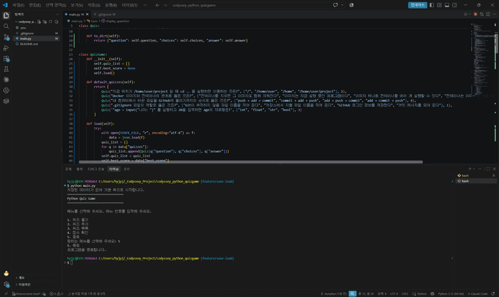
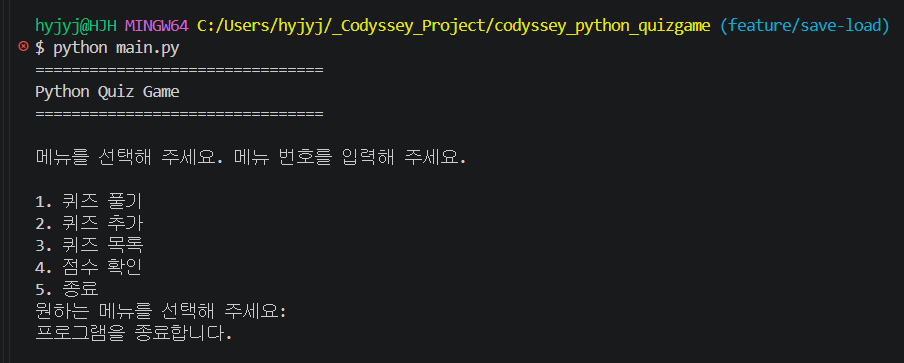
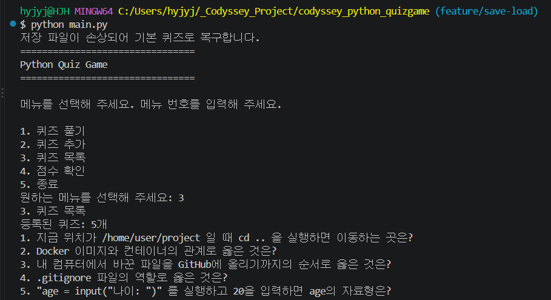
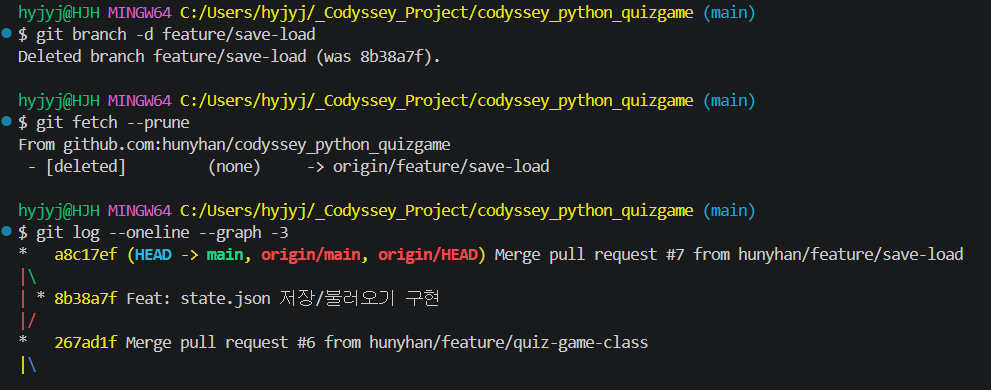

# state.json 저장/불러오기 (PR #7)

[← README로 돌아가기](../README.md)

퀴즈와 최고 점수를 `state.json`에 저장하고 실행할 때 불러옵니다. 파일 없음, 손상, `Ctrl+C` 종료를 확인했습니다.

## 저장/불러오기 코드 넣기



*코드를 넣고 첫 실행: 저장된 데이터가 없어 기본 퀴즈로 시작합니다, 바로 5로 종료. 탐색기에 state.json이 없음*



*Ctrl+C를 누른 화면: 빈 줄 다음 프로그램을 종료합니다, 프롬프트 앞에 빨간 표시*

<details>
<summary>터미널 원문 (핵심 부분)</summary>

```text
원하는 메뉴를 선택해 주세요: 2
문제를 입력해 주세요: 파이썬 확장자는?
...
퀴즈가 추가되었습니다.
원하는 메뉴를 선택해 주세요: 3
등록된 퀴즈: 6개
원하는 메뉴를 선택해 주세요: 1
...
총 점수: 6/6 (100.00%)
최고 점수를 갱신했습니다!
원하는 메뉴를 선택해 주세요: 5
$ python main.py                         (다시 실행)
원하는 메뉴를 선택해 주세요: 3
등록된 퀴즈: 6개
원하는 메뉴를 선택해 주세요: 4
최고 점수: 100.00%
```

</details>



*state.json 맨 앞 {를 지운 뒤 실행: 저장 파일이 손상되어 기본 퀴즈로 복구합니다, 목록 5개*

## 커밋과 PR #7

<details>
<summary>터미널 원문 (핵심 부분)</summary>

```text
$ git commit -m "Feat: state.json 저장/불러오기 구현"
[feature/save-load 8b38a7f] Feat: state.json 저장/불러오기 구현
 2 files changed, 79 insertions(+), 23 deletions(-)
$ git checkout main
$ git pull
   267ad1f..a8c17ef  main                    -> origin/main
 * [new branch]      feature/quiz-game-class -> origin/feature/quiz-game-class
Fast-forward
$ git branch -d feature/save-load
Deleted branch feature/save-load (was 8b38a7f).
$ git fetch --prune
 - [deleted]         (none)     -> origin/feature/save-load
```

</details>



*branch -d, fetch --prune, 그래프 맨 위 a8c17ef Merge pull request #7*
