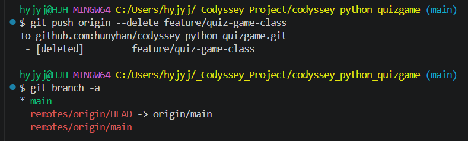
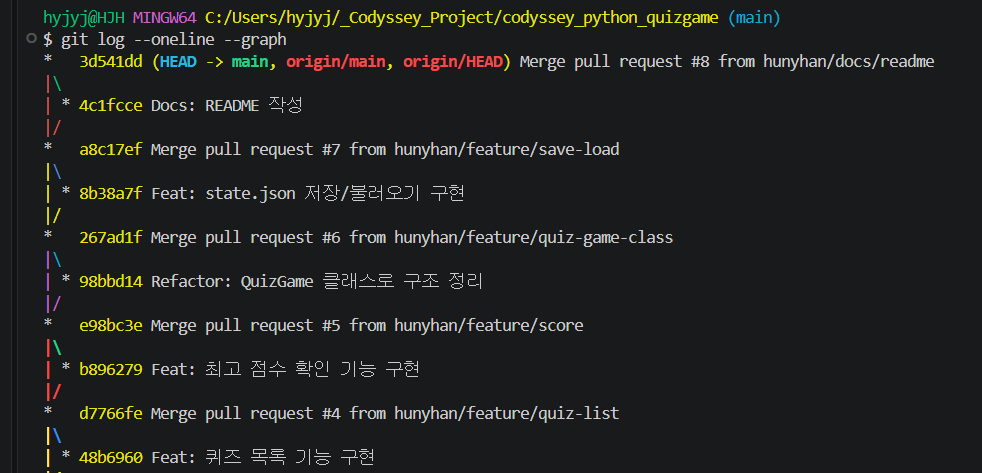

# README 작성 (PR #8)

[← README로 돌아가기](../README.md)

다시 생긴 원격 브랜치를 지우고, README를 Pull Request #8로 합쳤습니다.

## 다시 생긴 원격 브랜치 지우기



*push origin --delete로 feature/quiz-game-class를 지우고, git branch -a에 main과 origin/main만 남은 화면*

## README 작성과 PR #8

<details>
<summary>터미널 원문 (핵심 부분)</summary>

```text
$ git commit -m "Docs: README 작성"
[docs/readme 4c1fcce] Docs: README 작성
 1 file changed, 70 insertions(+), 1 deletion(-)
$ git push -u origin docs/readme
$ git checkout main
$ git pull
   a8c17ef..3d541dd  main       -> origin/main
Fast-forward
 README.md | 71 +++++...
$ git branch -d docs/readme
Deleted branch docs/readme (was 4c1fcce).
$ git fetch --prune
 - [deleted]         (none)     -> origin/docs/readme
$ git log --oneline --graph
*   3d541dd (HEAD -> main, origin/main, origin/HEAD) Merge pull request #8 from hunyhan/docs/readme
| * 4c1fcce Docs: README 작성
...
* a643000 Feat: 메뉴 출력과 입력, 예외 처리 구현
* 394c45b Initial commit
```

</details>



*그래프 맨 위 3d541dd Merge pull request #8, 4c1fcce Docs: README 작성, 아래로 PR #7~#4*
