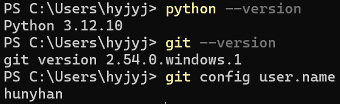
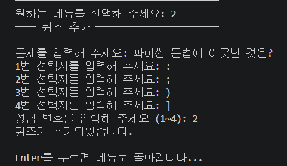
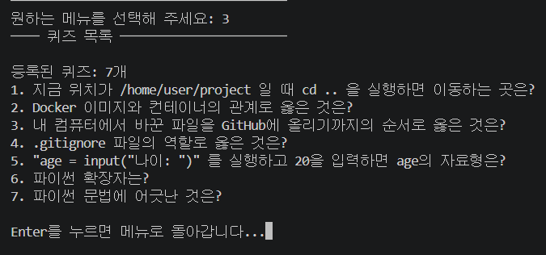
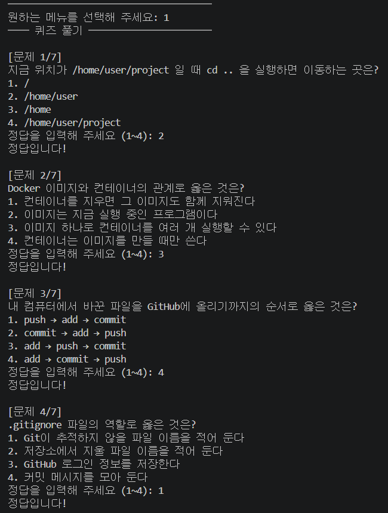
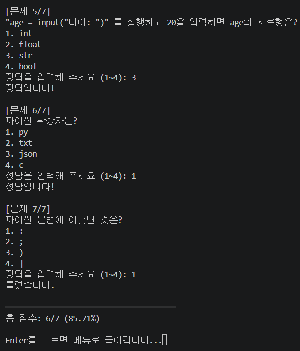
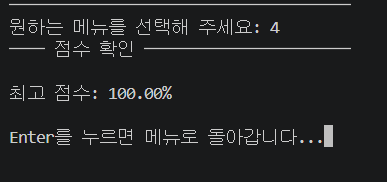

# 최종 실행 화면

[← README로 돌아가기](../README.md)

완성된 프로그램(`1655953 Style: 화면 지우기와 메뉴 디자인 정리`)을 VSCode Git Bash에서 실행한 화면입니다. 메뉴를 고르면 화면을 지우고 그 기능 화면만 보여 주며, Enter를 누르면 메뉴로 돌아갑니다.

## 개발 환경

*PowerShell에서 python --version은 Python 3.12.10, git --version은 2.54.0.windows.1, git config user.name은 hunyhan*

## 메뉴

![상자 안의 PYTHON QUIZ GAME, 등록된 퀴즈 6개와 최고 점수 100.00%, 메뉴 [1]~[5]](images/45-final-menu.png)

*상자 안의 PYTHON QUIZ GAME, 등록된 퀴즈 6개와 최고 점수 100.00%, 메뉴 [1]~[5]*

## 퀴즈 추가

*메뉴 2: 문제, 선택지 4개, 정답 번호를 입력하고 퀴즈가 추가되었습니다*

## 퀴즈 목록

*메뉴 3: 등록된 퀴즈 7개, 방금 추가한 7번 문제까지 보인다*

## 퀴즈 풀기

*메뉴 1: 문제 1/7~4/7, 문제마다 번호와 정답 안내*

*문제 5/7~7/7과 총 점수 6/7 (85.71%). 최고 점수 100.00%보다 낮아 갱신하지 않는다*

## 점수 확인

*메뉴 4: 최고 점수 100.00%*
