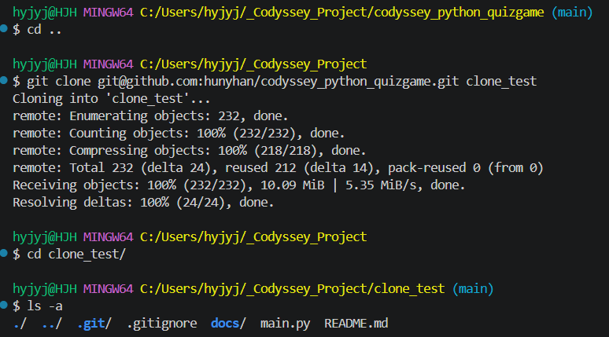
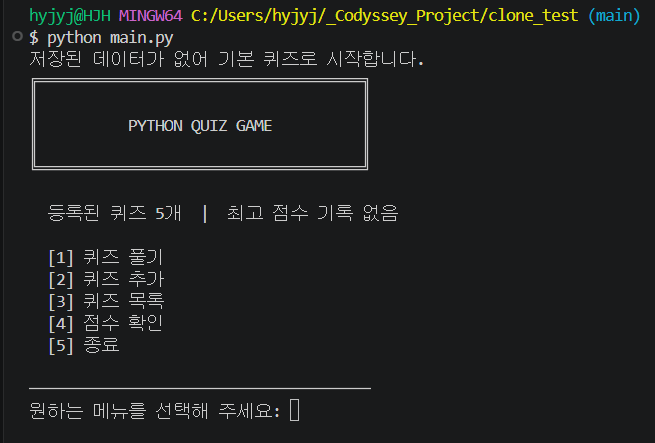
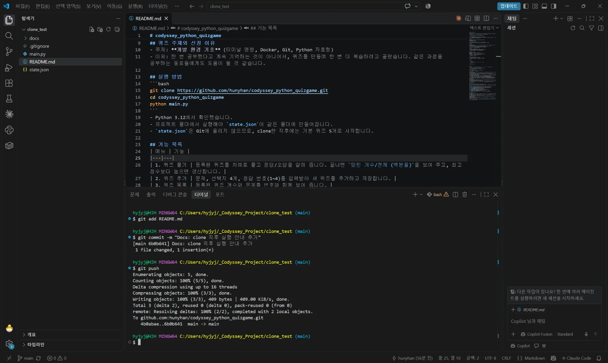
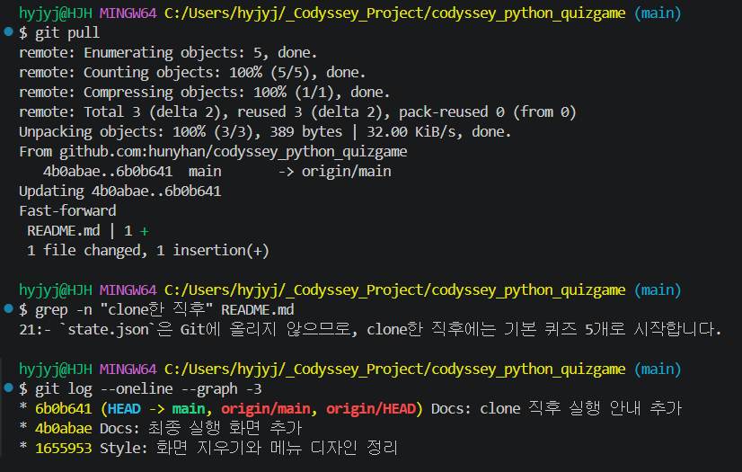

# 저장소 복제 실습

[← README로 돌아가기](../README.md)

같은 저장소를 두 곳에서 쓰는 상황을 폴더 두 개로 실습했습니다. 다른 폴더(`clone_test`)에 `git clone` → README 한 줄 수정 → `commit`, `push` → 원래 폴더(`codyssey_python_quizgame`)에서 `git pull`로 반영을 확인했습니다.

## 다른 폴더에 clone



*cd ..로 올라가 git clone ... clone_test, ls -a에 .git, .gitignore, docs, main.py, README.md. state.json은 없다*

`state.json`은 `.gitignore`로 Git에서 뺐기 때문에 clone해도 따라오지 않습니다.



*clone_test에서 실행: 저장된 데이터가 없어 기본 퀴즈로 시작합니다, 등록된 퀴즈 5개, 최고 점수 기록 없음*

## 한 줄 고쳐서 commit, push



*clone_test의 README 21번째 줄에 안내를 추가하고 git add, git commit 6b0b641, git push 4b0abae..6b0b641*

## 원래 폴더에서 pull



*원래 폴더에서 git pull 4b0abae..6b0b641 Fast-forward, grep으로 21번째 줄 확인, 그래프 맨 위 6b0b641*

<details>
<summary>터미널 원문 (핵심 부분)</summary>

```text
$ git pull
   4b0abae..6b0b641  main       -> origin/main
Updating 4b0abae..6b0b641
Fast-forward
 README.md | 1 +
$ grep -n "clone한 직후" README.md
21:- `state.json`은 Git에 올리지 않으므로, clone한 직후에는 기본 퀴즈 5개로 시작합니다.
$ git log --oneline --graph -3
* 6b0b641 (HEAD -> main, origin/main, origin/HEAD) Docs: clone 직후 실행 안내 추가
* 4b0abae Docs: 최종 실행 화면 추가
* 1655953 Style: 화면 지우기와 메뉴 디자인 정리
```

</details>
